# Activity Diagrams

> **Project:** AuditorX  
> **Document:** Activity Diagrams  
> **Status:** Draft  
> **Related SRS Section:** 4.5 การวิเคราะห์กระบวนการทำงานของระบบ

---

## 1. Purpose

เอกสารนี้รวบรวม Activity Diagram ของกระบวนการหลักใน AuditorX โดยใช้รหัสที่สัมพันธ์กับ Master Use Case เพื่อรักษา Traceability ระหว่าง Requirements, Use Cases, Design และ Test Cases

Diagram IDs ใช้รูปแบบ:

```text
AD-<Use Case Number>
```

ตัวอย่าง:

```text
UC-003 → AD-003
```

ไม่จำเป็นต้องสร้าง Activity Diagram สำหรับทุก Use Case หากกระบวนการนั้นเป็น CRUD หรือมีขั้นตอนไม่ซับซ้อน แต่ในเอกสารนี้กำหนด Diagram สำหรับกระบวนการหลักที่มีประโยชน์ต่อการออกแบบและพัฒนา

---

## 2. Activity Diagram Index

| Activity Diagram ID | Related Use Case | Process |
|---|---|---|
| AD-001 | UC-001 | Login |
| AD-002 | UC-002 | Repository Management |
| AD-003 | UC-003 | Source Code Scan |
| AD-004 | UC-004 | AI Analysis |
| AD-005 | UC-005 | Dashboard |
| AD-006 | UC-006 | Issue Review and Status Management |
| AD-007 | UC-007 | Search / Filter / Sort Issues |
| AD-008 | UC-008 | Report Generation |
| AD-009 | UC-009 | User and Permission Management |
| AD-010 | UC-010 | Scan History |
| AD-011 | UC-011 | MCP Context Access |
| AD-012 | UC-012 | Priority Model Evaluation and Activation |

---

## 3. AD-001 Login

**Related Use Case:** `UC-001`  
**Related Requirements:** `FR-AUTH-*`  
**Status:** Implemented

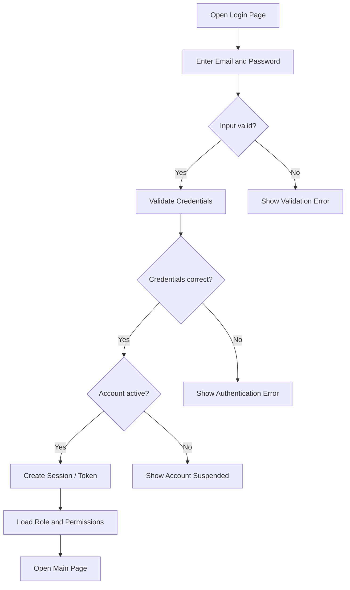

---

## 4. AD-002 Repository Management

**Related Use Case:** `UC-002`  
**Related Requirements:** `FR-REP-*`  
**Status:** Partially implemented — Add/List/View Access implemented; Edit and Delete flows (branches E/F/K/L/M) are not yet implemented

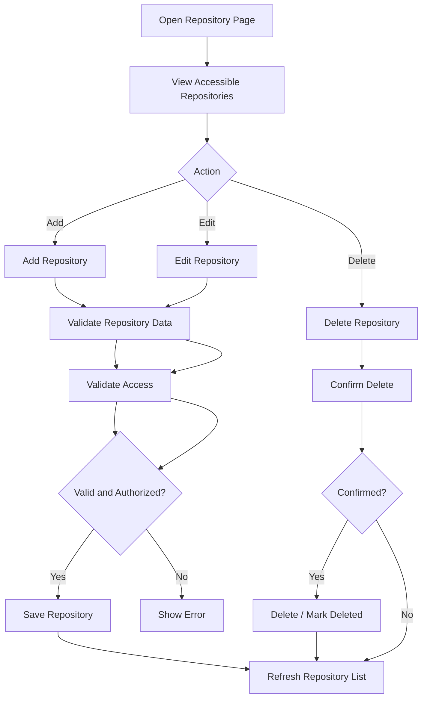

---

## 5. AD-003 Source Code Scan

**Related Use Case:** `UC-003`  
**Related Requirements:** `FR-SCAN-*`  
**Status:** Partially implemented — core scan lifecycle (create/run Semgrep/store findings/cancel/fail) is implemented; "Select Branch"/"Select Rule Set" (steps B, C) are not user-selectable (fixed to registered branch and a fixed rule profile), "Trigger AI Analysis" (step P) is not implemented, and priority prediction (step V) is not implemented

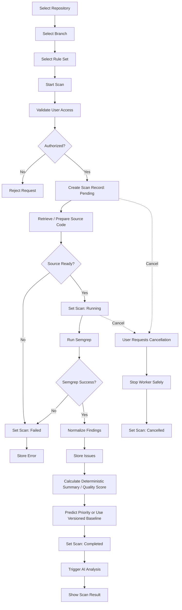

---

## 6. AD-004 AI Analysis

**Related Use Case:** `UC-004`  
**Related Requirements:** `FR-AI-*`  
**Status: Not yet implemented** — no AI/LLM integration exists in the codebase; this whole flow is planned scope

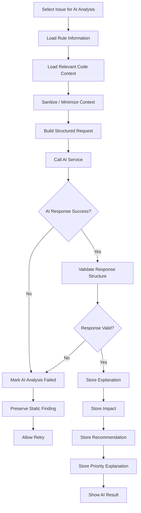

---

## 7. AD-005 Dashboard

**Related Use Case:** `UC-005`  
**Related Requirements:** `FR-DASH-*`  
**Status:** Partially implemented — covered partly by the real scan/findings view; Quality Score (F), Scan History trend (I), and AI Summary (J) are not yet implemented

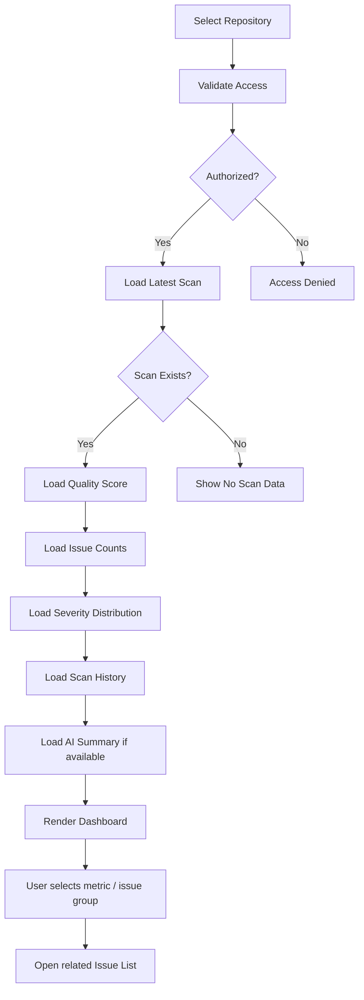

---

## 8. AD-006 Issue Review and Status Management

**Related Use Case:** `UC-006`  
**Related Requirements:** `FR-ISSUE-*`, `FR-PRIO-*`  
**Status:** Partially implemented — Finding detail (rule/file/line/severity) is implemented; Code Snippet (F), AI Explanation (G), Priority/Source/Confidence (P), Update Status (I), Add Note (J), and Submit Priority Label (Q) are not yet implemented (there is no persistent Issue entity, status field, or note field)

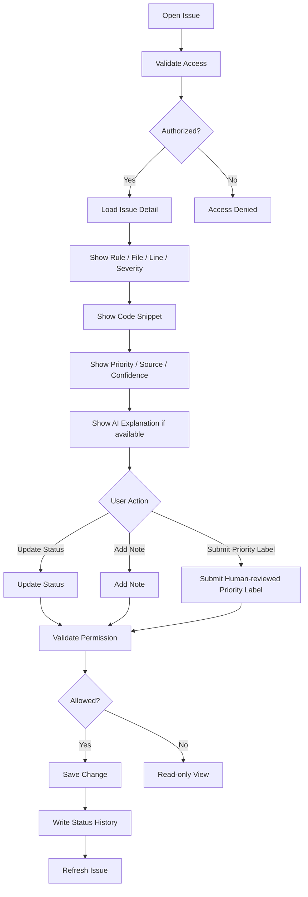

---

## 9. AD-007 Search / Filter / Sort Issues

**Related Use Case:** `UC-007`  
**Related Requirements:** `FR-FILTER-*`  
**Status:** Partially implemented — only text search and severity filter (step C, partial) exist; category/status/language filters and sort (step D) are not yet implemented

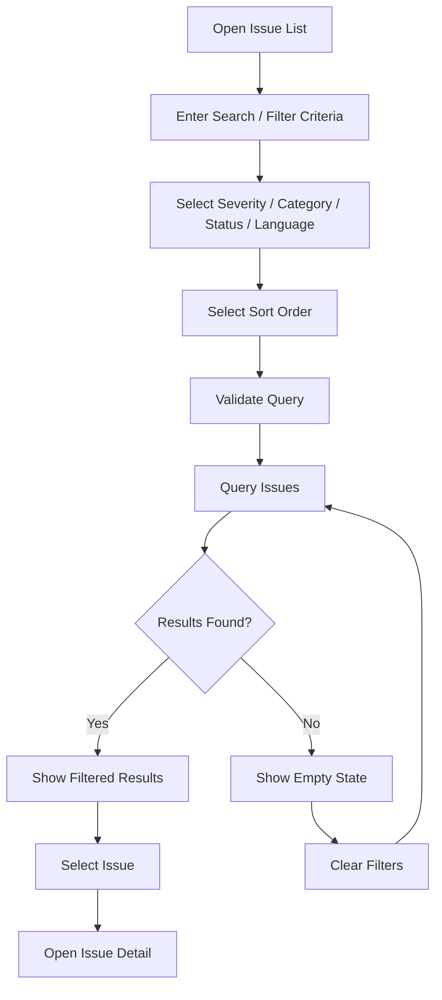

---

## 10. AD-008 Report Generation

**Related Use Case:** `UC-008`  
**Related Requirements:** `FR-REPORT-*`  
**Status: Not yet implemented** — no report generation or download endpoint exists in the codebase; this whole flow is planned scope

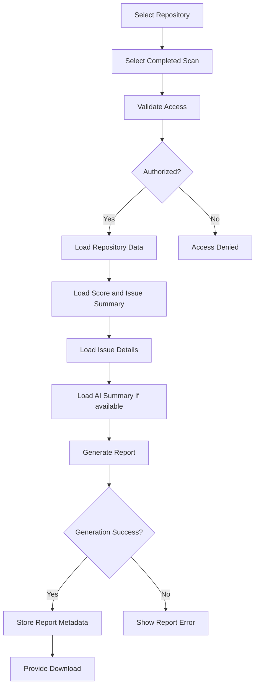

---

## 11. AD-009 User and Permission Management

**Related Use Case:** `UC-009`  
**Related Requirements:** `FR-USER-*`  
**Status:** Partially implemented — repository-level permission is implemented via membership roles (owner/editor/viewer) set at repository creation; the Administrator-facing user list/search/role-change/suspend flow shown here is not yet implemented

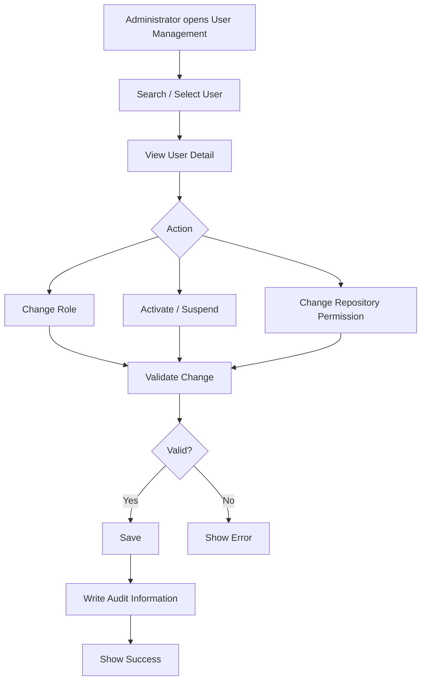

---

## 12. AD-010 Scan History

**Related Use Case:** `UC-010`  
**Related Requirements:** `FR-REP-008`, `FR-SCAN-009`  
**Status:** Implemented

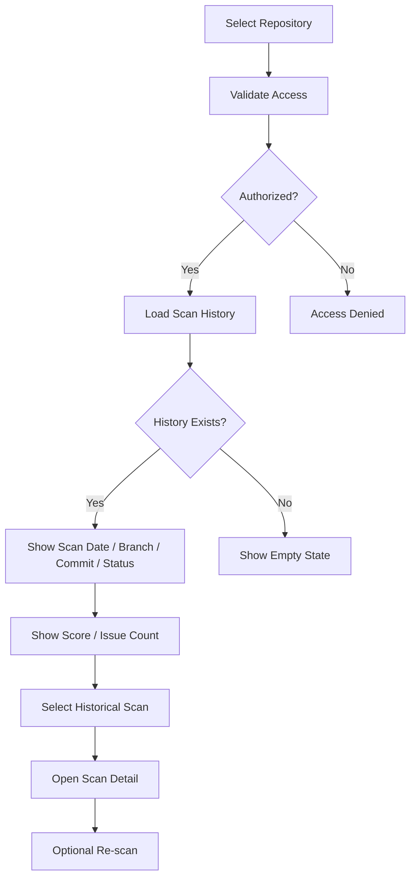

---

## 13. AD-011 MCP Context Access

**Related Use Case:** `UC-011`  
**Related Requirements:** `FR-MCP-*`  
**Status: Not yet implemented** — no MCP integration exists in the codebase; this whole flow is planned scope

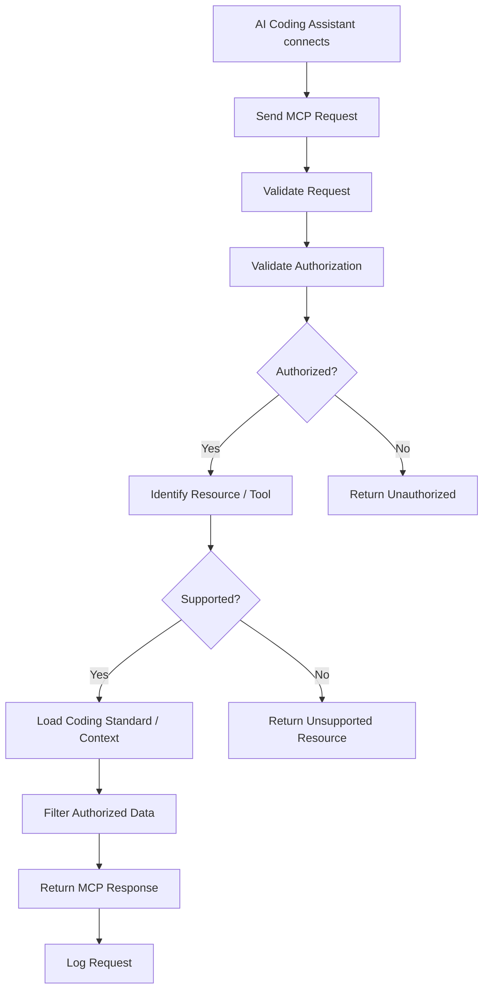

---

## 14. AD-012 Priority Model Evaluation and Activation

**Related Use Case:** `UC-012`  
**Related Requirements:** `FR-PRIO-006`, `FR-PRIO-007`  
**Status: Not yet implemented** — no supervised ML / priority-prediction engine exists in the codebase; this whole flow is planned scope

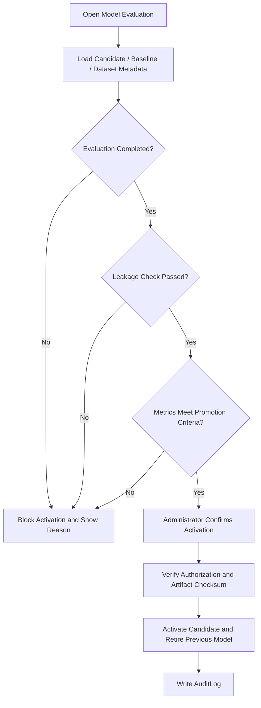

---

## 15. Activity Diagram Traceability

| Activity Diagram | Use Case | Requirement |
|---|---|---|
| AD-001 | UC-001 | `FR-AUTH-*` |
| AD-002 | UC-002 | `FR-REP-*` |
| AD-003 | UC-003 | `FR-SCAN-*` |
| AD-004 | UC-004 | `FR-AI-*` |
| AD-005 | UC-005 | `FR-DASH-*` |
| AD-006 | UC-006 | `FR-ISSUE-*`, `FR-PRIO-001`–`FR-PRIO-005`, `FR-PRIO-008` |
| AD-007 | UC-007 | `FR-FILTER-*` |
| AD-008 | UC-008 | `FR-REPORT-*` |
| AD-009 | UC-009 | `FR-USER-*` |
| AD-010 | UC-010 | `FR-REP-008`, `FR-SCAN-009` |
| AD-011 | UC-011 | `FR-MCP-*` |
| AD-012 | UC-012 | `FR-PRIO-006`, `FR-PRIO-007` |

---

## 15. Design Notes

- Activity Diagrams describe workflow, not component-level communication.
- Component communication will be defined in Sequence Diagrams.
- Business logic that is not visible to users may be refined in architecture documents.
- Diagram IDs must remain stable once referenced by SRS or Test Cases.
