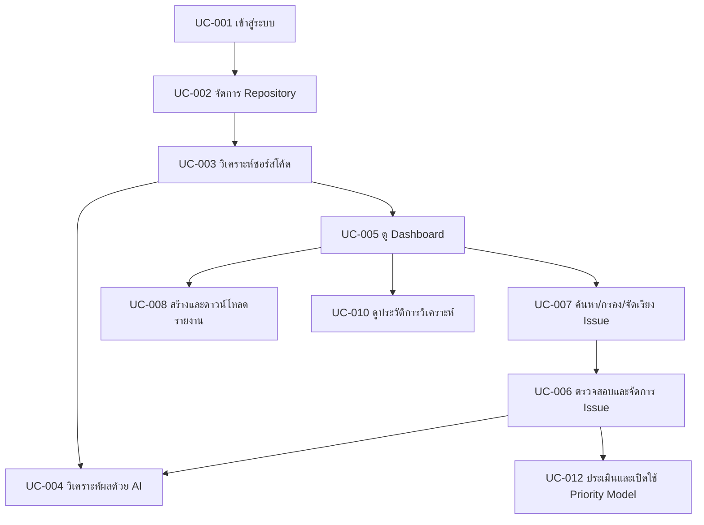

# AuditorX Use Cases

> **Document:** Use Case Specification  
> **Project:** AuditorX  
> **Status:** Draft  
> **Related SRS Section:** 4.4 การวิเคราะห์กรณีใช้งาน  
> **Source of Truth:** Use Case IDs in this document must match the SRS and Requirements Traceability Matrix.

---

## 1. Purpose

เอกสารนี้กำหนดกรณีใช้งาน (Use Cases) หลักของระบบ **AuditorX** เพื่อใช้เป็นรายละเอียดเชิงเทคนิคสำหรับการออกแบบ การพัฒนา การทดสอบ และการตรวจสอบย้อนกลับของข้อกำหนด

Use Case ID ในเอกสารนี้ต้องใช้รหัสเดียวกันกับเอกสาร SRS, Activity Diagram, Sequence Diagram, Test Case และ Requirements Traceability Matrix

---

## 2. Actors

| Actor | Description |
|---|---|
| Administrator | ผู้ดูแลระบบ มีสิทธิ์จัดการผู้ใช้งาน บทบาท และสิทธิ์การเข้าถึง |
| Project Manager / Reviewer | ผู้ตรวจสอบภาพรวมคุณภาพของ Repository ติดตาม Issue และรายงาน |
| Developer | ผู้เพิ่ม Repository สั่ง Scan ตรวจสอบ Issue และนำคำแนะนำไปปรับปรุงซอร์สโค้ด |
| AI Coding Assistant | External Actor ที่เรียกใช้ข้อมูลผ่าน MCP Prototype |

---

## 3. Master Use Case List

| Use Case ID | Use Case | Primary Actor | Related Requirements |
|---|---|---|---|
| UC-001 | เข้าสู่ระบบ | Administrator, Project Manager/Reviewer, Developer | `FR-AUTH-*` |
| UC-002 | จัดการ Repository | Developer, Administrator | `FR-REP-*` |
| UC-003 | วิเคราะห์ซอร์สโค้ด | Developer, Administrator, Project Manager/Reviewer (limited) | `FR-SCAN-*` |
| UC-004 | วิเคราะห์ผลด้วยปัญญาประดิษฐ์ | Developer, Project Manager/Reviewer | `FR-AI-*` |
| UC-005 | ดู Dashboard | Administrator, Project Manager/Reviewer, Developer | `FR-DASH-*` |
| UC-006 | ตรวจสอบและจัดการรายละเอียด Issue | Developer, Project Manager/Reviewer, Administrator | `FR-ISSUE-*`, `FR-PRIO-*` |
| UC-007 | ค้นหา กรอง และจัดเรียง Issue | Developer, Project Manager/Reviewer, Administrator | `FR-FILTER-*` |
| UC-008 | สร้างและดาวน์โหลดรายงาน | Developer, Project Manager/Reviewer, Administrator | `FR-REPORT-*` |
| UC-009 | จัดการผู้ใช้งานและสิทธิ์ | Administrator | `FR-USER-*` |
| UC-010 | ดูประวัติการวิเคราะห์ | Developer, Project Manager/Reviewer, Administrator | `FR-REP-008`, `FR-SCAN-009` |
| UC-011 | เข้าถึง Coding Standards ผ่าน MCP | AI Coding Assistant | `FR-MCP-*` |
| UC-012 | ประเมินและเปิดใช้ Priority Model | Administrator | `FR-PRIO-006`, `FR-PRIO-007` |

---

# 4. Use Case Specifications

## UC-001 เข้าสู่ระบบ

**Primary Actors:** Administrator, Project Manager/Reviewer, Developer  
**Related Requirements:** `FR-AUTH-*`  
**Status:** Implemented (registration/login/logout via Supabase Auth)

### Description

ผู้ใช้งานยืนยันตัวตนเพื่อเข้าใช้งาน AuditorX ตามบทบาทและสิทธิ์ที่ได้รับ

### Preconditions

- ผู้ใช้งานมีบัญชีในระบบ
- บัญชีอยู่ในสถานะที่สามารถใช้งานได้

### Trigger

ผู้ใช้งานเปิดหน้าเข้าสู่ระบบและกรอกข้อมูลเข้าสู่ระบบ

### Main Flow

1. ผู้ใช้งานกรอกอีเมลและรหัสผ่าน
2. ระบบตรวจสอบรูปแบบข้อมูล
3. ระบบค้นหาบัญชีผู้ใช้งานจากอีเมล
4. ระบบตรวจสอบรหัสผ่าน
5. ระบบตรวจสอบสถานะบัญชี
6. ระบบสร้าง Session หรือ Token
7. ระบบโหลดข้อมูลบทบาทและสิทธิ์ของผู้ใช้งาน
8. ระบบนำผู้ใช้งานเข้าสู่หน้าหลัก

### Alternative / Exception Flows

- หากข้อมูลไม่ครบ ระบบแจ้งให้ผู้ใช้งานกรอกข้อมูลที่จำเป็น
- หากอีเมลหรือรหัสผ่านไม่ถูกต้อง ระบบปฏิเสธการเข้าสู่ระบบ
- หากบัญชีถูกระงับ ระบบไม่อนุญาตให้เข้าสู่ระบบ

### Postconditions

- ผู้ใช้งานที่ยืนยันตัวตนสำเร็จสามารถเข้าถึงฟังก์ชันตามสิทธิ์ของตน
- ระบบมี Session หรือ Token สำหรับการใช้งานต่อเนื่อง

---

## UC-002 จัดการ Repository

**Primary Actors:** Developer, Administrator  
**Related Requirements:** `FR-REP-*`  
**Status:** Partially implemented — add/list/access-validation implemented (public HTTPS github.com repositories only, no credentials); search, edit, and delete are not yet implemented

### Description

ผู้ใช้งานเพิ่ม ดู แก้ไข หรือจัดการ Repository ที่ต้องการนำเข้าสู่กระบวนการวิเคราะห์

### Preconditions

- ผู้ใช้งานเข้าสู่ระบบแล้ว
- ผู้ใช้งานมีสิทธิ์จัดการ Repository
- กรณี Private Repository ผู้ใช้งานต้องมีสิทธิ์เข้าถึง Repository ต้นทาง

### Trigger

ผู้ใช้งานเปิดหน้าจัดการ Repository

### Main Flow

1. ระบบแสดงรายการ Repository ที่ผู้ใช้งานมีสิทธิ์เข้าถึง
2. ผู้ใช้งานเลือกเพิ่ม Repository
3. ผู้ใช้งานระบุข้อมูล Repository
4. ระบบตรวจสอบข้อมูลและสิทธิ์การเข้าถึง
5. ระบบดึง Metadata ที่จำเป็นจากแหล่ง Repository
6. ระบบบันทึกข้อมูล Repository
7. ระบบแสดง Repository ในรายการของผู้ใช้งาน

### Alternative / Exception Flows

- หาก Repository ไม่สามารถเข้าถึงได้ ระบบแจ้งข้อผิดพลาด
- หากผู้ใช้งานไม่มีสิทธิ์ ระบบปฏิเสธการเพิ่ม Repository
- หาก Repository ถูกเพิ่มไว้แล้ว ระบบแจ้งให้ผู้ใช้งานทราบ
- ผู้ใช้งานที่มีสิทธิ์สามารถแก้ไข Branch เริ่มต้นหรือรายละเอียด Repository
- ผู้ใช้งานที่มีสิทธิ์สามารถลบ Repository โดยระบบต้องขอคำยืนยัน

### Postconditions

- Repository ถูกบันทึกหรือแก้ไขใน AuditorX
- Repository พร้อมสำหรับการเลือกเพื่อ Scan

---

## UC-003 วิเคราะห์ซอร์สโค้ด

**Primary Actors:** Developer, Administrator, Project Manager/Reviewer (limited)  
**Related Requirements:** `FR-SCAN-*`  
**Status:** Partially implemented — start/status/store-findings/error-handling/re-scan/cancel are implemented via Semgrep; Branch and Rule Set selection (main flow steps 2–3) are not user-selectable (fixed to the repository's registered branch and a fixed "recommended" rule profile), and Priority Prediction (step 15) / LLM Explanation (step 17) are not yet implemented

### Description

ผู้ใช้งานเลือก Repository, Branch และ Rule Set แล้วสั่งให้ AuditorX วิเคราะห์ซอร์สโค้ดด้วย Semgrep

### Preconditions

- ผู้ใช้งานเข้าสู่ระบบแล้ว
- Repository ถูกเพิ่มเข้าสู่ AuditorX แล้ว
- ผู้ใช้งานมีสิทธิ์เข้าถึง Repository
- Semgrep พร้อมใช้งาน

### Trigger

ผู้ใช้งานกดคำสั่งเริ่มการวิเคราะห์

### Main Flow

1. ผู้ใช้งานเลือก Repository
2. ผู้ใช้งานเลือก Branch
3. ผู้ใช้งานเลือกหรือยืนยัน Rule Set
4. ระบบตรวจสอบสิทธิ์ของผู้ใช้งาน
5. ระบบสร้าง Scan Record
6. ระบบกำหนดสถานะ Scan เป็น Pending
7. ระบบจัดเตรียมหรือดึง Source Code
8. ระบบเปลี่ยนสถานะเป็น Running
9. ระบบเรียกใช้ Semgrep
10. Semgrep วิเคราะห์ Source Code ตาม Rule Set
11. ระบบรับผลลัพธ์จาก Semgrep
12. ระบบแปลง Semgrep Finding เป็น AuditorX Issue
13. ระบบบันทึก Issue ลงฐานข้อมูล
14. ระบบคำนวณข้อมูลสรุปและ deterministic Code Quality Score
15. ระบบสร้าง Priority Prediction ด้วย Active model หรือ versioned baseline fallback
16. ระบบกำหนดสถานะ Scan เป็น Completed
17. ระบบเริ่มกระบวนการ LLM Explanation ตามเงื่อนไขที่กำหนดโดยส่ง persisted Priority เป็น context
18. ระบบแจ้งผลการ Scan แก่ผู้ใช้งาน

### Alternative / Exception Flows

- หากดึง Source Code ไม่สำเร็จ ระบบกำหนด Scan เป็น Failed
- หาก Semgrep ทำงานไม่สำเร็จ ระบบบันทึก Error และกำหนด Scan เป็น Failed
- หากไม่มี Finding ระบบบันทึกผล Scan เป็น Completed โดยมีจำนวน Issue เท่ากับศูนย์
- ผู้ใช้งานที่มีสิทธิ์สามารถยกเลิก Scan ที่เป็น Pending หรือ Running; ระบบหยุด Worker อย่างปลอดภัยและกำหนดสถานะเป็น Cancelled

### Postconditions

- Scan History ถูกบันทึก
- Finding ที่ตรวจพบถูกจัดเก็บเป็น Issue
- ผล Scan สามารถนำไปใช้กับ Dashboard, AI Analysis และ Report

---

## UC-004 วิเคราะห์ผลด้วยปัญญาประดิษฐ์

**Primary Actors:** Developer, Project Manager/Reviewer  
**Related Requirements:** `FR-AI-*`  
**Status: Not yet implemented** — no AI/LLM integration exists in the codebase; this use case describes planned scope only

### Description

ระบบใช้ LLM เพื่ออธิบาย Issue ที่ตรวจพบจาก Static Analysis วิเคราะห์ผลกระทบ และเสนอแนวทางปรับปรุงซอร์สโค้ด

### Preconditions

- มี Issue ที่ได้จาก Scan
- มีข้อมูล Rule และ Code Context ที่จำเป็น
- บริการ AI พร้อมใช้งาน

### Trigger

- ระบบเริ่ม AI Analysis หลังจาก Scan ตาม Workflow ที่กำหนด หรือ
- ผู้ใช้งานร้องขอคำอธิบายหรือวิเคราะห์ใหม่

### Main Flow

1. ระบบเลือก Issue ที่ต้องวิเคราะห์
2. ระบบรวบรวม Rule Information
3. ระบบรวบรวม Code Snippet และ Context ที่จำเป็น
4. ระบบตรวจสอบและลดข้อมูลที่ไม่จำเป็นก่อนส่งออก
5. ระบบสร้าง Prompt หรือ Structured Request
6. ระบบส่งคำขอไปยัง LLM
7. LLM ส่งผลการวิเคราะห์กลับ
8. ระบบตรวจสอบรูปแบบผลลัพธ์
9. ระบบบันทึกคำอธิบาย
10. ระบบบันทึกผลกระทบ
11. ระบบบันทึกคำแนะนำในการแก้ไข
12. ระบบบันทึกคำอธิบายของ persisted Priority โดยไม่เปลี่ยน Prediction
13. ระบบแสดงผลแก่ผู้ใช้งาน

### Alternative / Exception Flows

- หาก AI Service ไม่พร้อมใช้งาน ระบบต้องยังคงแสดงผลจาก Semgrep
- หาก AI Response ไม่ตรงรูปแบบ ระบบบันทึกสถานะผิดพลาด
- ผู้ใช้งานสามารถร้องขอให้วิเคราะห์ใหม่ได้ตามเงื่อนไขที่กำหนด

### Postconditions

- Issue มี AI Analysis เชื่อมโยงอยู่
- ผู้ใช้งานสามารถดูคำอธิบาย ผลกระทบ และคำแนะนำได้
- ผล AI ไม่แก้ไข Source Code โดยอัตโนมัติ

---

## UC-005 ดู Dashboard

**Primary Actors:** Administrator, Project Manager/Reviewer, Developer  
**Related Requirements:** `FR-DASH-*`  
**Status:** Partially implemented — covered partly by the real scan/findings view; Code Quality Score, Scan Trend, and AI Summary (main flow steps 3, 7, 8) are not yet implemented

### Description

ผู้ใช้งานดูภาพรวมคุณภาพของ Repository จากผล Scan และ Issue ที่ระบบจัดเก็บ

### Preconditions

- ผู้ใช้งานเข้าสู่ระบบแล้ว
- ผู้ใช้งานมีสิทธิ์เข้าถึง Repository

### Trigger

ผู้ใช้งานเลือก Repository หรือเปิดหน้า Dashboard

### Main Flow

1. ระบบตรวจสอบสิทธิ์ Repository
2. ระบบโหลดผล Scan ล่าสุด
3. ระบบโหลด Code Quality Score
4. ระบบโหลดจำนวน Issue
5. ระบบจัดกลุ่ม Issue ตาม Severity
6. ระบบจัดกลุ่ม Issue ตามประเภท
7. ระบบโหลดประวัติหรือแนวโน้มการวิเคราะห์
8. ระบบโหลด AI Summary หากมี
9. ระบบแสดง Dashboard
10. ผู้ใช้งานสามารถเลือกข้อมูลเพื่อไปยังรายการ Issue ที่เกี่ยวข้อง

### Alternative / Exception Flows

- หาก Repository ยังไม่เคย Scan ระบบแสดงสถานะ No Scan Data
- หาก AI Summary ไม่มี ระบบยังคงแสดงข้อมูล Static Analysis ได้

### Postconditions

- ผู้ใช้งานเห็นภาพรวมคุณภาพของ Repository
- ผู้ใช้งานสามารถนำทางไปยัง Issue หรือ Scan History ได้

---

## UC-006 ตรวจสอบและจัดการรายละเอียด Issue

**Primary Actors:** Developer, Project Manager/Reviewer, Administrator  
**Related Requirements:** `FR-ISSUE-*`, `FR-PRIO-*`  
**Status:** Partially implemented — Finding detail (rule/file/line/severity) is implemented; there is no persistent Issue entity, so Code Snippet, Priority Prediction, AI Explanation, status change, note, and status history (main flow steps 6–13) are not yet implemented

### Description

ผู้ใช้งานตรวจสอบรายละเอียดปัญหาที่ตรวจพบ รวมถึงตำแหน่ง Code, Severity, predicted Priority พร้อม source/confidence, AI Recommendation และจัดการสถานะหรือ human-reviewed Priority Label ตามสิทธิ์

### Preconditions

- ผู้ใช้งานเข้าสู่ระบบแล้ว
- ผู้ใช้งานมีสิทธิ์เข้าถึง Repository
- มี Issue อยู่ในระบบ

### Trigger

ผู้ใช้งานเลือก Issue จาก Dashboard หรือ Issue List

### Main Flow

1. ระบบตรวจสอบสิทธิ์ของผู้ใช้งาน
2. ระบบโหลดรายละเอียด Issue
3. ระบบแสดง Rule ID และ Rule Description
4. ระบบแสดง Severity และประเภทปัญหา
5. ระบบแสดงชื่อไฟล์และตำแหน่งบรรทัด
6. ระบบแสดง Code Snippet
7. ระบบแสดง Priority Prediction, source, version และ confidence
8. ระบบแสดง AI Explanation และ Recommendation หากมี
9. ผู้ใช้งานตรวจสอบข้อมูล
10. ผู้ใช้งานที่มีสิทธิ์สามารถเปลี่ยนสถานะ Issue
11. Reviewer/Administrator ที่มีสิทธิ์สามารถยืนยันหรือแก้ Priority Label พร้อมเหตุผล
12. ผู้ใช้งานสามารถเพิ่มหมายเหตุ
13. ระบบบันทึกการเปลี่ยนแปลงแบบตรวจสอบย้อนหลังได้โดยไม่แก้ Prediction เดิม

### Supported Issue Status

ค่าที่เสนอสำหรับระบบต้นแบบ:

- `Open`
- `In Progress`
- `Resolved`
- `Accepted Risk`
- `False Positive`

### Alternative / Exception Flows

- หากไม่มี AI Analysis ระบบแสดง Static Analysis Finding ตามปกติ
- หาก Priority Model ไม่พร้อม ระบบแสดง Priority จาก versioned baseline พร้อม source indicator
- หากผู้ใช้งานไม่มีสิทธิ์เปลี่ยนสถานะ ระบบแสดงข้อมูลแบบ Read-only
- หาก Issue ไม่พบ ระบบแสดง Not Found

### Postconditions

- รายละเอียด Issue ถูกแสดง
- การเปลี่ยนสถานะหรือหมายเหตุถูกบันทึก
- Issue Status History สามารถตรวจสอบย้อนหลังได้
- Priority Prediction และ human-reviewed Label สามารถตรวจสอบย้อนหลังแยกจากกันได้

---

## UC-007 ค้นหา กรอง และจัดเรียง Issue

**Primary Actors:** Developer, Project Manager/Reviewer, Administrator  
**Related Requirements:** `FR-FILTER-*`  
**Status:** Partially implemented — only text search and severity filter exist; filtering by category/status/language and sorting (main flow steps 4–7) are not yet implemented

### Description

ผู้ใช้งานค้นหา กรอง และจัดเรียงรายการ Issue เพื่อค้นหาปัญหาที่ต้องการตรวจสอบหรือจัดลำดับความสำคัญ

### Preconditions

- ผู้ใช้งานเข้าสู่ระบบแล้ว
- ผู้ใช้งานมีสิทธิ์เข้าถึง Repository
- Repository มีผลการวิเคราะห์

### Trigger

ผู้ใช้งานเปิด Issue List และกำหนดเงื่อนไขการค้นหา

### Main Flow

1. ระบบแสดง Issue List
2. ผู้ใช้งานระบุ Keyword หรือ Filter
3. ผู้ใช้งานสามารถกรองตาม Severity
4. ผู้ใช้งานสามารถกรองตามประเภทปัญหา
5. ผู้ใช้งานสามารถกรองตาม Status
6. ผู้ใช้งานสามารถกรองตาม Programming Language
7. ผู้ใช้งานเลือกเงื่อนไขการจัดเรียง
8. ระบบประมวลผลเงื่อนไข
9. ระบบแสดงรายการ Issue ที่ตรงเงื่อนไข
10. ผู้ใช้งานสามารถเลือก Issue เพื่อดูรายละเอียด

### Alternative / Exception Flows

- หากไม่มีข้อมูลตรงเงื่อนไข ระบบแสดง Empty State
- ผู้ใช้งานสามารถล้างเงื่อนไขทั้งหมดเพื่อกลับไปดูรายการเต็ม

### Postconditions

- รายการ Issue แสดงตามเงื่อนไขที่ผู้ใช้งานกำหนด

---

## UC-008 สร้างและดาวน์โหลดรายงาน

**Primary Actors:** Developer, Project Manager/Reviewer, Administrator  
**Related Requirements:** `FR-REPORT-*`  
**Status: Not yet implemented** — no report generation or download endpoint exists in the codebase; this use case describes planned scope only

### Description

ผู้ใช้งานสร้างรายงานจากผลการวิเคราะห์ Repository และดาวน์โหลดรายงานตามรูปแบบที่ระบบรองรับ

### Preconditions

- ผู้ใช้งานเข้าสู่ระบบแล้ว
- ผู้ใช้งานมีสิทธิ์เข้าถึง Repository
- Repository มี Scan ที่เสร็จสมบูรณ์

### Trigger

ผู้ใช้งานเลือกคำสั่งสร้างรายงาน

### Main Flow

1. ผู้ใช้งานเลือก Repository
2. ผู้ใช้งานเลือก Scan ที่ต้องการ
3. ระบบตรวจสอบสิทธิ์
4. ระบบโหลดข้อมูล Repository
5. ระบบโหลด Code Quality Score
6. ระบบโหลด Issue Summary
7. ระบบโหลด Issue Detail
8. ระบบโหลด AI Summary หากมี
9. ระบบสร้าง Report
10. ระบบบันทึกข้อมูลอ้างอิงของ Report
11. ระบบแสดงสถานะว่าสร้างรายงานสำเร็จ
12. ผู้ใช้งานดาวน์โหลดรายงาน

### Alternative / Exception Flows

- หาก Scan ยังไม่เสร็จ ระบบไม่อนุญาตให้สร้างรายงานฉบับสมบูรณ์
- หาก AI Summary ไม่มี ระบบสามารถสร้างรายงานจาก Static Analysis Data ได้
- หากสร้างไฟล์ไม่สำเร็จ ระบบแจ้ง Error และไม่บันทึกสถานะว่า Success

### Postconditions

- Report ถูกสร้างและอ้างอิงกับ Repository และ Scan
- ผู้ใช้งานสามารถดาวน์โหลด Report ตามสิทธิ์

---

## UC-009 จัดการผู้ใช้งานและสิทธิ์

**Primary Actor:** Administrator  
**Related Requirements:** `FR-USER-*`  
**Status:** Partially implemented — repository permission assignment (FR-USER-005) is implemented via membership roles (owner/editor/viewer) set at repository creation; Administrator user list/search/account-status/role-management (FR-USER-001–004) are not yet implemented

### Description

Administrator จัดการบัญชีผู้ใช้งาน บทบาท สถานะบัญชี และสิทธิ์การเข้าถึง Repository

### Preconditions

- Administrator เข้าสู่ระบบแล้ว
- Administrator มีสิทธิ์ User Management

### Trigger

Administrator เปิดหน้าจัดการผู้ใช้งาน

### Main Flow

1. ระบบแสดงรายการผู้ใช้งาน
2. Administrator ค้นหาหรือเลือกผู้ใช้งาน
3. ระบบแสดงข้อมูลผู้ใช้งานและบทบาท
4. Administrator เปลี่ยนบทบาทได้
5. Administrator เปิดใช้งานหรือระงับบัญชีได้
6. Administrator กำหนดสิทธิ์ Repository ได้
7. ระบบตรวจสอบข้อมูล
8. ระบบบันทึกการเปลี่ยนแปลง
9. ระบบบันทึก Audit Information
10. ระบบแสดงผลการดำเนินการ

### Alternative / Exception Flows

- หากผู้ใช้งานเป้าหมายไม่พบ ระบบแสดง Not Found
- หากข้อมูล Role ไม่ถูกต้อง ระบบปฏิเสธการเปลี่ยนแปลง
- ระบบต้องป้องกันการดำเนินการที่ทำให้ระบบไม่เหลือ Administrator หากมีการกำหนดกฎดังกล่าว

### Postconditions

- บทบาท สถานะ หรือสิทธิ์ Repository ถูกอัปเดต
- การดำเนินการสามารถตรวจสอบย้อนหลังได้

---

## UC-010 ดูประวัติการวิเคราะห์

**Primary Actors:** Developer, Project Manager/Reviewer, Administrator  
**Related Requirements:** `FR-REP-008`, `FR-SCAN-009`  
**Status:** Implemented

### Description

ผู้ใช้งานตรวจสอบประวัติ Scan ของ Repository เพื่อดูผลการวิเคราะห์ย้อนหลังและเปรียบเทียบการเปลี่ยนแปลงของคุณภาพซอร์สโค้ด

### Preconditions

- ผู้ใช้งานเข้าสู่ระบบแล้ว
- ผู้ใช้งานมีสิทธิ์เข้าถึง Repository

### Trigger

ผู้ใช้งานเปิดหน้า Scan History ของ Repository

### Main Flow

1. ระบบตรวจสอบสิทธิ์ Repository
2. ระบบโหลดรายการ Scan
3. ระบบแสดงวันและเวลา
4. ระบบแสดง Branch และ Commit หากมี
5. ระบบแสดง Scan Status
6. ระบบแสดง Code Quality Score
7. ระบบแสดงจำนวน Issue
8. ผู้ใช้งานเลือก Scan เพื่อดูรายละเอียดได้
9. ผู้ใช้งานสามารถใช้ข้อมูลเพื่อเปรียบเทียบผลในแต่ละรอบ

### Alternative / Exception Flows

- หาก Repository ยังไม่เคย Scan ระบบแสดง Empty State
- Scan ที่ Failed ต้องยังปรากฏใน History พร้อม Error Information ที่เหมาะสม

### Postconditions

- ผู้ใช้งานสามารถตรวจสอบผลการวิเคราะห์ย้อนหลังได้

---

## UC-011 เข้าถึง Coding Standards ผ่าน MCP

**Primary Actor:** AI Coding Assistant  
**Related Requirements:** `FR-MCP-*`  
**Status: Not yet implemented** — no MCP integration exists in the codebase; this use case describes planned scope only

### Description

AI Coding Assistant เรียกใช้ MCP Prototype ของ AuditorX เพื่อเข้าถึง Coding Standards, Best Practices หรือ Project Context ที่ระบบอนุญาต

### Preconditions

- MCP Prototype เปิดใช้งาน
- Client รองรับ Model Context Protocol
- Client มีสิทธิ์ตามกลไกที่ Prototype กำหนด

### Trigger

AI Coding Assistant ส่ง MCP Request มายัง AuditorX

### Main Flow

1. MCP Client เชื่อมต่อกับ AuditorX MCP Endpoint
2. ระบบตรวจสอบ Request
3. ระบบตรวจสอบสิทธิ์ หากมีการกำหนด
4. Client ขอ Resource หรือ Tool ที่รองรับ
5. AuditorX โหลดข้อมูล Coding Standard หรือ Context
6. ระบบกรองข้อมูลตามสิทธิ์
7. ระบบส่งข้อมูลกลับผ่าน MCP
8. AI Coding Assistant นำข้อมูลไปใช้เป็น Context สำหรับการพัฒนา

### Alternative / Exception Flows

- หาก Resource ไม่พบ ระบบส่ง Error Response
- หากไม่มีสิทธิ์ ระบบปฏิเสธ Request
- หาก MCP Service ไม่พร้อมใช้งาน Client ไม่สามารถดึง Context ได้
- ระบบต้องไม่เปิดเผย Source Code หรือข้อมูลที่ไม่ได้รับอนุญาต

### Postconditions

- AI Coding Assistant ได้รับเฉพาะข้อมูล Context ที่ได้รับอนุญาต
- การเรียกใช้งานสามารถถูกบันทึกเพื่อการตรวจสอบได้

---

## UC-012 ประเมินและเปิดใช้ Priority Model

**Primary Actor:** Administrator  
**Related Requirements:** `FR-PRIO-006`, `FR-PRIO-007`  
**Status: Not yet implemented** — no supervised ML / priority-prediction engine exists in the codebase; this use case describes planned scope only

### Description

Administrator ตรวจสอบ EvaluationRun ที่สร้างจาก offline pipeline เปรียบเทียบ candidate model กับ severity baseline และเปิดใช้โมเดลที่ผ่านเกณฑ์

### Preconditions

- Candidate model, dataset version และ EvaluationRun ถูกบันทึกแล้ว
- EvaluationRun เป็น Completed
- Leakage check เป็น Passed
- ผู้ใช้งานเป็น Administrator

### Trigger

Administrator เปิดหน้า Model Evaluation และเลือก candidate model

### Main Flow

1. ระบบโหลด candidate, baseline, dataset/split และ reproducibility metadata
2. ระบบแสดง Macro-F1, per-class metrics, Critical Recall และ Confusion Matrix
3. ระบบตรวจสอบ promotion criteria
4. Administrator ตรวจผลและยืนยันการเปิดใช้
5. Backend ตรวจ authorization และ artifact checksum
6. ระบบเปลี่ยน candidate เป็น Active และ retire Active model เดิมใน transaction เดียวกัน
7. ระบบบันทึก AuditLog

### Alternative / Exception Flows

- หาก leakage check ไม่ผ่าน ระบบห้ามเปิดใช้
- หาก Candidate Macro-F1 หรือ Critical Recall ต่ำกว่า baseline ระบบห้ามเปิดใช้
- หาก artifact/version ไม่ตรงกับ EvaluationRun ระบบห้ามเปิดใช้
- หากไม่มี candidate ผ่านเกณฑ์ ระบบใช้ baseline หรือ Active model เดิมต่อไป

### Postconditions

- มี Active priority predictor เพียงหนึ่ง version
- EvaluationRun และ activation event ตรวจสอบย้อนหลังได้

---

# 5. Use Case Relationships

กระบวนการหลักของ AuditorX มีความสัมพันธ์โดยสรุปดังนี้



หมายเหตุ: Diagram นี้แสดงความสัมพันธ์เชิง Workflow โดยสรุป ไม่ได้หมายความว่า Use Case ทุกตัวเป็น UML `include` หรือ `extend`

---

# 6. Traceability Rules

เพื่อป้องกันความไม่สอดคล้องของเอกสาร ให้ใช้กฎดังต่อไปนี้

1. Use Case ID ต้องตรงกันทุกเอกสาร
2. ห้ามเปลี่ยนความหมายของ Use Case ID เดิมโดยไม่อัปเดต SRS
3. Use Case ใหม่ต้องเพิ่มใน Master Use Case List ก่อน
4. Requirement ที่เกี่ยวข้องต้องถูกอ้างอิงในแต่ละ Use Case
5. Activity Diagram และ Sequence Diagram ควรใช้หมายเลขที่สัมพันธ์กับ Use Case เมื่อต้องการ Trace โดยตรง
6. Test Case ต้องอ้างอิง Requirement หรือ Use Case ที่ทดสอบ
7. หาก Word SRS และ Markdown ไม่ตรงกัน ให้ใช้ SRS ฉบับที่ได้รับอนุมัติล่าสุดเป็นข้อกำหนดหลัก

ตัวอย่าง:

```text
FR-SCAN-001
    ↓
UC-003
    ↓
AD-003
    ↓
SD-003
    ↓
TC-SCAN-001
```

---

# 7. Related Documents

| Document | Suggested Path |
|---|---|
| System Context | [`docs/04-architecture/system-context.md`](../04-architecture/system-context.md) |
| Requirements | [`docs/02-requirements/requirements.md`](../02-requirements/requirements.md) |
| Requirements Traceability | [`docs/02-requirements/traceability.md`](../02-requirements/traceability.md) |
| Activity Diagrams | [`docs/03-analysis/activity-diagrams.md`](activity-diagrams.md) |
| Sequence Diagrams | [`docs/04-architecture/sequence-diagrams.md`](../04-architecture/sequence-diagrams.md) |
| API Overview | [`docs/06-api/api-overview.md`](../06-api/api-overview.md) |
| Data Model | [`docs/05-database/data-model.md`](../05-database/data-model.md) |
| Test Cases | [`docs/10-testing/test-cases.md`](../10-testing/test-cases.md) |
| Priority Engine | [`docs/04-architecture/priority-engine.md`](../04-architecture/priority-engine.md) |
| Issue Prioritization | [`docs/09-ai/issue-prioritization.md`](../09-ai/issue-prioritization.md) |
| Evaluation Protocol | [`docs/10-testing/evaluation-protocol.md`](../10-testing/evaluation-protocol.md) |

---

# 8. Open Design Decisions

รายละเอียดต่อไปนี้ยังต้องกำหนดเพิ่มเติมระหว่างการออกแบบระบบ:

- Authentication mechanism และ Session/Token strategy
- GitHub authentication flow
- Final Semgrep rule IDs included in each MVP profile
- Issue Status transition rules
- Background job/queue implementation
- AI Structured Output schema
- AI context window / code snippet strategy
- Report file format
- MCP Resources และ Tools ที่รองรับ

เมื่อมีข้อสรุป ประเด็นเหล่านี้ควรถูกย้ายไปยังเอกสาร Architecture หรือ Design Decision ที่เกี่ยวข้อง
