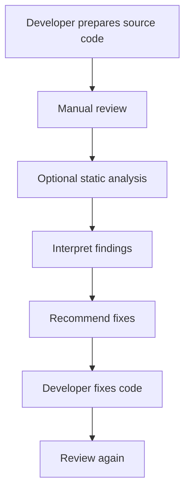
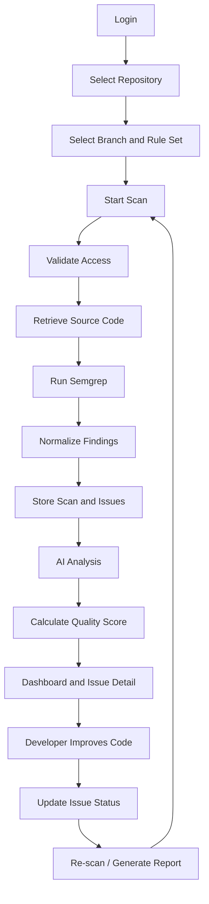

# Users and Workflows

> **Project:** AuditorX  
> **Document:** Users and Workflows  
> **Status:** Draft  
> **Related SRS Section:** 4.2 การวิเคราะห์ผู้ใช้งานและกระบวนการทำงาน

---

## 1. Purpose

เอกสารนี้อธิบายผู้ใช้งานหลักของ AuditorX เป้าหมายของผู้ใช้งานแต่ละประเภท และกระบวนการทำงานหลักของระบบ เพื่อใช้เป็นพื้นฐานสำหรับ Use Case, Activity Diagram, UI Design และ Access Control

> **Status: เอกสารนี้อธิบาย workflow ตามขอบเขตที่ตั้งใจไว้ (planned scope) ทั้งหมด** ปัจจุบันมีเพียง Authentication, Repository management (add/list) และ Scan pipeline (Semgrep) ที่ implement จริง ส่วน AI Analysis, Priority Prediction/Model Evaluation, Reporting, MCP Access และ Administrator user-management ยังไม่มี implementation ดูรายละเอียดต่อ Requirement ใน `../02-requirements/requirements.md`

---

## 2. Actors

### 2.1 Administrator

Administrator รับผิดชอบการบริหารจัดการระบบและสิทธิ์การใช้งาน

Responsibilities:

- Manage users
- Assign roles
- Activate or suspend accounts
- Manage repository access
- Review audit information
- View system-level information
- Submit human-reviewed Priority Labels
- Review EvaluationRuns and activate eligible Priority Models

Related Requirements:

- `FR-AUTH-*`
- `FR-USER-*`
- `FR-PRIO-*`

Related Use Cases:

- `UC-001`
- `UC-002`
- `UC-005`
- `UC-006`
- `UC-008`
- `UC-009`
- `UC-012`

---

### 2.2 Project Manager / Reviewer

Project Manager / Reviewer ใช้ AuditorX เพื่อติดตามภาพรวมคุณภาพของ Repository ตรวจสอบ Issue และติดตามผลการปรับปรุง

Responsibilities:

- View Dashboard
- Review Code Quality Score
- Review issues
- Filter and sort issues
- Review AI recommendations
- Track issue status
- Review scan history
- Generate reports
- Submit human-reviewed Priority Labels with rationale

Related Requirements:

- `FR-DASH-*`
- `FR-ISSUE-*`
- `FR-FILTER-*`
- `FR-REPORT-*`
- `FR-PRIO-005`

Related Use Cases:

- `UC-001`
- `UC-004`
- `UC-005`
- `UC-006`
- `UC-007`
- `UC-008`
- `UC-010`

---

### 2.3 Developer

Developer เป็นผู้ใช้งานหลักของกระบวนการ Source Code Analysis

Responsibilities:

- Add repositories
- Select repository and branch
- Start scans
- Review findings
- View file and line information
- Review AI explanation
- Update issue status
- Add issue notes
- Re-scan repositories
- Compare scan results

Related Requirements:

- `FR-REP-*`
- `FR-SCAN-*`
- `FR-AI-*`
- `FR-ISSUE-*`

Related Use Cases:

- `UC-001`
- `UC-002`
- `UC-003`
- `UC-004`
- `UC-005`
- `UC-006`
- `UC-007`
- `UC-008`
- `UC-010`

---

### 2.4 AI Coding Assistant

AI Coding Assistant เป็น External Actor สำหรับ MCP Prototype

Responsibilities:

- Request Coding Standards
- Request Best Practices
- Request authorized project context

Related Requirements:

- `FR-MCP-*`

Related Use Case:

- `UC-011`

---

## 3. Role Capability Matrix

| Capability | Administrator | Project Manager / Reviewer | Developer | AI Coding Assistant |
|---|:---:|:---:|:---:|:---:|
| Login | ✓ | ✓ | ✓ | - |
| Manage Repository | ✓ | Limited | ✓ | - |
| Start Scan | ✓ | Limited | ✓ | - |
| View Dashboard | ✓ | ✓ | ✓ | - |
| View Issue Detail | ✓ | ✓ | ✓ | - |
| Update Issue Status | ✓ | Limited | ✓ | - |
| View AI Recommendation | ✓ | ✓ | ✓ | - |
| View Predicted Priority | ✓ | ✓ | ✓ | - |
| Submit Priority Label | ✓ | ✓ | - | - |
| View/Activate Priority Model | ✓ | - | - | - |
| Search / Filter Issues | ✓ | ✓ | ✓ | - |
| Generate Report | ✓ | ✓ | ✓ | - |
| Manage Users | ✓ | - | - | - |
| View Scan History | ✓ | ✓ | ✓ | - |
| Access MCP Context | - | - | - | ✓ |

> ตารางนี้เป็น baseline สิทธิ์สำหรับ MVP และเป็น source of truth ของเอกสารวิเคราะห์/UI การเปลี่ยนสิทธิ์ต้องอัปเดต Use Case, Navigation และ API authorization พร้อมกัน

> **Status:** Capability ที่ implement แล้วในปัจจุบัน ได้แก่ Login, Start Scan, View Scan History, View Issue Detail (แสดงเป็น Finding ไม่มี Code Snippet/AI) — Manage Repository และ Search/Filter Issues เป็นแบบ partial (เพิ่ม/ดูรายการเท่านั้น ไม่มีแก้ไข/ลบ/ค้นหา Repository; filter มีเฉพาะ text search + severity) และ View Dashboard เป็นแบบ partial ผ่านหน้า scan/findings จริง Capability ที่เหลือทั้งหมด (Update Issue Status, View AI Recommendation, View Predicted Priority, Submit Priority Label, View/Activate Priority Model, Generate Report, Manage Users, Access MCP Context) ยังไม่มี implementation

---

## 4. Current Review Workflow

ก่อนใช้ AuditorX กระบวนการตรวจสอบซอร์สโค้ดโดยทั่วไปอาจประกอบด้วย:

1. Developer prepares source code or Pull Request.
2. Reviewer manually reviews code.
3. Static Analysis Tool may be run separately.
4. Reviewer interprets technical findings.
5. Reviewer explains issues and recommends changes.
6. Developer modifies source code.
7. Reviewer re-checks changes.
8. Reports may be created manually if required.



---

## 5. Current Workflow Problems

### 5.1 High Review Effort

Manual review requires time and depends on repository size and reviewer availability.

### 5.2 Reviewer-dependent Results

Different reviewers may identify or prioritize issues differently.

### 5.3 Technical Findings Are Hard to Interpret

Static analysis outputs may contain rule IDs, file paths and technical messages without enough explanation for less experienced developers.

### 5.4 Fragmented Tooling

Repository data, scan results, explanations and reports may be distributed across multiple tools.

### 5.5 Weak Prioritization

Large numbers of findings can make it difficult to decide what should be fixed first.

### 5.6 Manual Reporting

Summary reports may require manual aggregation.

### 5.7 Limited Historical Comparison

Without scan history, it is difficult to determine whether repository quality is improving or degrading.

---

## 6. Proposed AuditorX Workflow



---

## 7. Workflow by Actor

### Administrator

```text
Login
→ View users
→ Assign role / suspend account
→ Manage repository permission
→ Review audit information
```

### Project Manager / Reviewer

```text
Login
→ Select repository
→ View dashboard
→ Filter issues
→ Review AI recommendation
→ Track issue status
→ View history / generate report
```

### Developer

```text
Login
→ Add/select repository
→ Start scan
→ Review issues
→ View AI explanation
→ Improve source code
→ Update issue status
→ Re-scan
```

### AI Coding Assistant

```text
Connect via MCP
→ Request coding standard / context
→ AuditorX validates request
→ Receive authorized context
```

---

## 8. Primary Inputs and Outputs

| Process | Input | Output |
|---|---|---|
| Authentication | Email, Password | Session/Token, Role |
| Repository Management | Repository URL, Branch | Repository Record |
| Scan | Repository, Branch, Rule Set | Scan Record, Findings |
| Semgrep Analysis | Source Code, Rule Set | Static Findings |
| AI Analysis | Finding, Rule, Code Context | Explanation, Impact, Recommendation |
| Dashboard | Repository, Scan | Score, Issue Summary, AI Summary |
| Issue Management | Issue ID, Status, Note | Updated Issue, History |
| Report | Repository, Scan | Report |
| MCP | Context Request | Authorized Standards / Context |

---

## 9. Expected Benefits

AuditorX is intended to:

- Reduce repetitive manual review work
- Standardize rule-based detection
- Improve understanding of static analysis findings
- Centralize scan results and AI explanations
- Improve issue prioritization
- Preserve scan and issue history
- Support report generation
- Support future AI coding governance via MCP

---

## 10. Traceability

| Workflow Area | Requirement Group | Use Case |
|---|---|---|
| Authentication | `FR-AUTH-*` | `UC-001` |
| Repository | `FR-REP-*` | `UC-002`, `UC-010` |
| Scan | `FR-SCAN-*` | `UC-003`, `UC-010` |
| AI Analysis | `FR-AI-*` | `UC-004` |
| Dashboard | `FR-DASH-*` | `UC-005` |
| Issue | `FR-ISSUE-*` | `UC-006` |
| Issue Prioritization / Evaluation | `FR-PRIO-*` | `UC-006`, `UC-012` |
| Search / Filter | `FR-FILTER-*` | `UC-007` |
| Reporting | `FR-REPORT-*` | `UC-008` |
| User Management | `FR-USER-*` | `UC-009` |
| MCP | `FR-MCP-*` | `UC-011` |
