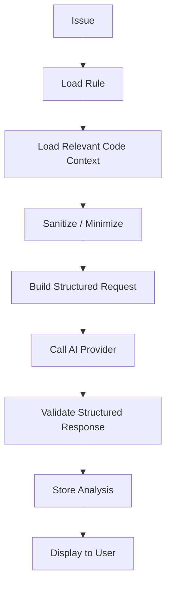

# AI Analysis Engine

> **Project:** AuditorX  
> **Provider:** OpenAI API (initial implementation)  
> **Status:** Draft

---

> **Implementation status: Not yet built.** This document describes planned/target
> architecture. No AI/LLM engine, provider integration, or AI-related module exists in the
> repository as of 2026-09-12. The current backend implements only authentication (`user`),
> repository management (`project`), and Semgrep-based scanning (`scan`) — see `backend.md`
> and `static-analysis.md` for what is actually implemented.

---

## 1. Purpose

AI Analysis Engine ทำหน้าที่อธิบายและวิเคราะห์ผลจาก Static Analysis โดยไม่ทำหน้าที่เป็นแหล่งตรวจจับหลักของ AuditorX

---

## 2. Responsibilities

- Explain issue
- Describe potential impact
- Recommend remediation
- Explain the persisted priority and its relevant evidence
- Generate repository-level summary
- Re-analyze on request

AI must not:

- automatically modify source code
- automatically commit code
- override static findings without explicit rules
- generate, relabel or overwrite Issue Priority
- claim certainty where context is insufficient

---

## 3. Input Context

Minimum required context may include:

```text
language
rule_id
rule_description
severity
predicted_priority
priority_source
priority_confidence
file_path
code_snippet
limited surrounding context
```

Only minimum necessary source code should be sent.

---

## 4. AI Flow



---

## 5. Expected Structured Output

Suggested conceptual fields:

```json
{
  "summary": "...",
  "root_cause": "...",
  "impact": "...",
  "recommendation": "...",
  "priority_explanation": "...",
  "confidence_note": "..."
}
```

Final JSON schema will be defined in `docs/09-ai/structured-output.md`.

---

## 6. Prompt Principles

- Give clear role and task
- Include rule metadata
- Provide only relevant source context
- Require structured output
- Require uncertainty acknowledgement
- Do not ask model to invent unavailable repository context
- Do not request automatic modification

---

## 7. Security and Privacy

Before calling AI:

- remove credentials where detected
- minimize source context
- avoid sending whole repository
- avoid sending unnecessary personal data
- log metadata, not sensitive prompt payloads

---

## 8. Failure Handling

If AI provider fails:

- keep Semgrep findings
- set AI analysis status to failed/unavailable
- allow manual review
- allow retry
- do not mark entire scan failed

---

## 9. Provider Abstraction

Recommended interface:

```text
AIProvider.AnalyzeIssue(...)
AIProvider.SummarizeRepository(...)
```

This allows future provider replacement without rewriting issue-domain logic.

---

## 10. Traceability

Related:
- `UC-004`
- `FR-AI-*`
- `NFR-SEC-007`
- `NFR-SEC-008`
- `NFR-REL-001`
