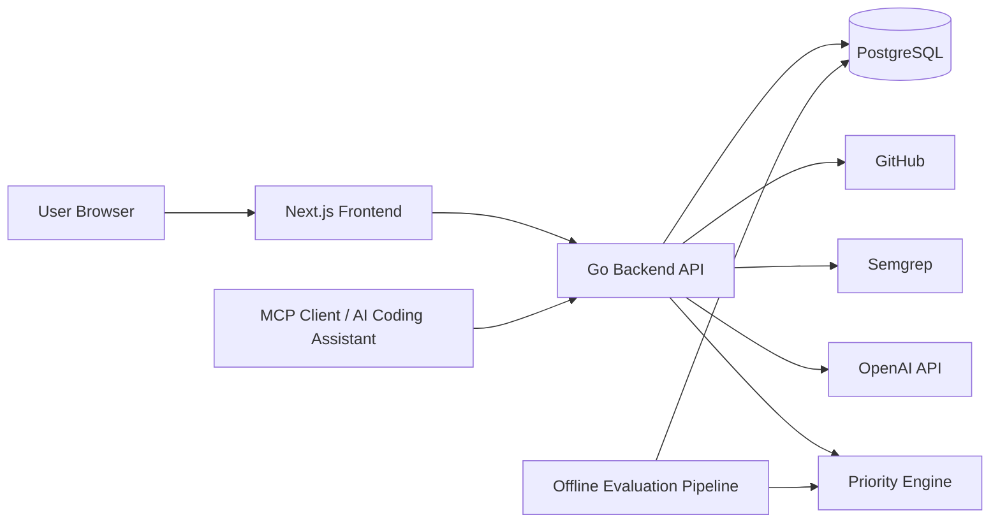
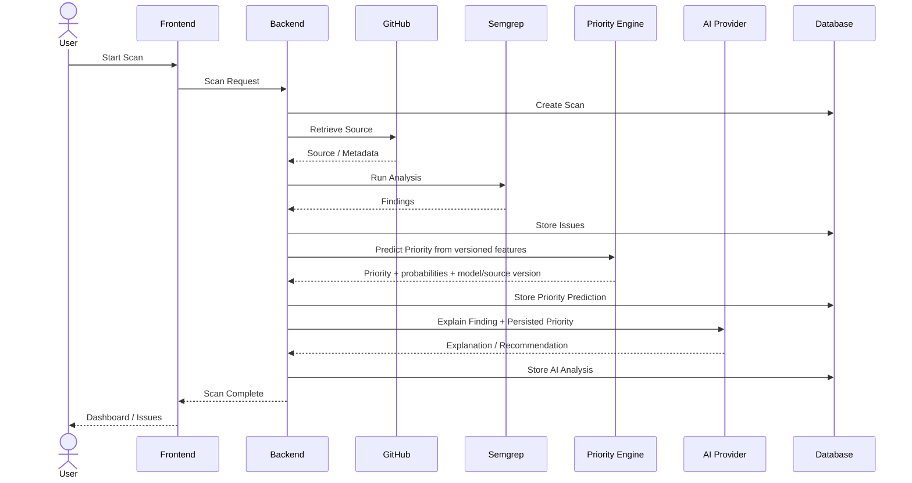

# Architecture Overview

> **Project:** AuditorX  
> **Document:** Architecture Overview  
> **Status:** Draft  
> **Related SRS Section:** 4.6 การออกแบบสถาปัตยกรรมซอฟต์แวร์

---

## 1. Purpose

เอกสารนี้อธิบายสถาปัตยกรรมระดับสูงของ AuditorX และความรับผิดชอบขององค์ประกอบหลัก เพื่อใช้เป็นฐานสำหรับ Backend, Frontend, Static Analysis, AI, Security, Deployment และ API Design

---

## 1.1 Implementation Status (as of 2026-09-12)

This document describes the full target architecture. Today, only the Frontend, Backend API,
PostgreSQL (via Supabase), GitHub source retrieval and the Semgrep-based Static Analysis Engine
are implemented, and only for public repositories in a local-development environment (see
`backend.md`, `static-analysis.md` and `deployment.md`). The **Priority Engine**, **Model
Evaluation Pipeline**, **AI Analysis Engine**, **Report Service** and **MCP Prototype**
referenced throughout this document (including the Core Components table, the Main Workflow
diagram in section 7, and the diagrams below) are **not yet built** — see `priority-engine.md`,
`ai-engine.md` and `mcp.md` for their planned-only status. The Main Workflow in section 7 should
be read as the target end-to-end flow; the currently implemented flow stops after "Store Issues"
(no priority prediction, no AI explanation step).

---

## 2. Architecture Style

AuditorX ใช้แนวทาง Web Application แบบแยก Frontend และ Backend โดย Backend เป็นศูนย์กลางในการควบคุม Business Logic และ Integration

```text
Browser
  ↓
Next.js Frontend
  ↓
Go Backend API
  ├── PostgreSQL
  ├── GitHub
  ├── Semgrep
  ├── Priority Model / Baseline
  ├── OpenAI API
  └── MCP Prototype
```

---

## 3. Core Components

| Component | Responsibility |
|---|---|
| Frontend | UI, Dashboard, Forms, Issue Detail, Report UI |
| Backend API | Authentication, Authorization, Business Logic, Orchestration |
| PostgreSQL | Persistent application data |
| Repository Integration | Repository metadata and source retrieval |
| Static Analysis Engine | Run Semgrep and normalize findings |
| Priority Engine | Extract features, predict priority and apply baseline fallback |
| Model Evaluation Pipeline | Train/evaluate candidate prioritizers and register approved versions |
| AI Analysis Engine | Explain findings and recommend remediation |
| Report Service | Build downloadable analysis reports |
| MCP Prototype | Expose authorized standards/context to AI assistants |

---

## 4. High-Level Component Diagram



---

## 5. Architectural Responsibilities

### Frontend
- Render application pages
- Capture user input
- Call backend APIs
- Present scan status and results
- Present AI explanation and recommendations
- Enforce UI-level permission visibility

### Backend
- Authenticate and authorize users
- Validate requests
- Manage repositories and scans
- Orchestrate source retrieval
- Execute Semgrep
- Normalize findings
- Manage issues
- Run versioned priority inference or baseline fallback
- Call AI provider
- Calculate Code Quality Score
- Generate reports
- Persist data
- Log security and audit events

### Database
- Store users, roles and permissions
- Store repositories
- Store scan records
- Store normalized issues
- Store issue status history
- Store AI analysis
- Store labels, model versions, predictions and evaluation runs
- Store report metadata
- Store audit information

---

## 6. Architecture Principles

### Separation of Concerns
Semgrep detects; AI explains; AuditorX orchestrates and presents.

### Backend as Trust Boundary
Frontend input is never trusted without backend validation.

### Graceful Degradation
AI failure must not invalidate successful static analysis.

### Traceability
All important results must be traceable:

```text
Repository
→ Branch
→ Commit
→ Scan
→ Issue
→ AI Analysis
```

### Least Privilege
Users and external integrations receive only the access required for their function.

### Replaceable Integrations
External providers should be wrapped behind internal interfaces where practical.

---

## 7. Main Workflow



---

## 8. Related Requirements

- `FR-AUTH-*`
- `FR-REP-*`
- `FR-SCAN-*`
- `FR-AI-*`
- `FR-PRIO-*`
- `FR-DASH-*`
- `FR-ISSUE-*`
- `FR-FILTER-*`
- `FR-REPORT-*`
- `FR-USER-*`
- `FR-MCP-*`
- `NFR-*`

---

## 9. Open Decisions

- Authentication token/session strategy
- GitHub authorization strategy
- Background job execution model
- Repository temporary storage
- Deployment target
