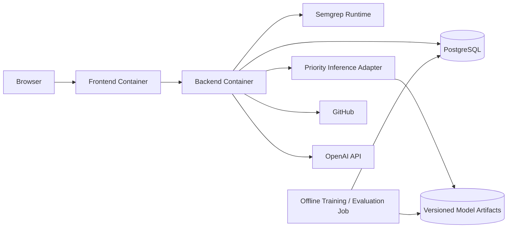

# Deployment Architecture

> **Project:** AuditorX  
> **Status:** Draft

---

## 1. Purpose

เอกสารนี้กำหนด Deployment Model เบื้องต้นสำหรับ AuditorX Prototype

---

## 1.1 Current State vs. Planned (as of 2026-09-12)

**Current state: local development only.** The repository provisions no production
environment, no CI/CD deploy pipeline, and no cloud infrastructure anywhere. The only working
setup is `scripts/dev-local.ps1`, which on a single Windows machine:

- starts Docker Desktop and a local Supabase CLI stack (Supabase CLI 2.116.0) on a
  localhost-only Docker network,
- provisions a temporary, dedicated `NOLOGIN`/`NOINHERIT` scan-worker Postgres login for the
  session (removed on shutdown),
- builds and runs the Go API (`cmd/api`) and scan worker (`cmd/scan-worker`) as local binaries
  with `REPOSITORY_STORAGE=postgres` and `SCAN_QUEUE_ENABLED=true`, and
- runs the Next.js frontend via `next dev`.

There is no Docker image build for the frontend/backend used in this flow (a `frontend/Dockerfile`
exists but is not wired into `dev-local.ps1`), no container orchestration, no managed database,
and no reverse proxy/CDN in front of anything. `scripts/verify.ps1` and
`scripts/verify-scanner.ps1` provide repeatable local verification, not deployment.

**Everything from section 2 onward that describes containers, environment separation beyond
local, or a production-like target is planned architecture**, not the current state. It is kept
here as the intended direction for when a production deployment is undertaken.

---

## 2. Logical Deployment (Planned/Target)



---

## 3. Services

### Frontend Service
- Next.js
- serves UI
- communicates with backend only

### Backend Service
- Go API
- business logic
- integrations
- scan orchestration

### Database Service
- PostgreSQL

### Semgrep Runtime
May run:
- in backend container, or
- in isolated worker/container

Isolated execution is preferred if implementation complexity allows.

### Priority Inference
- loaded behind the Backend `PriorityPredictor` adapter
- verifies artifact checksum and feature schema before activation
- falls back to the versioned severity baseline on failure

### Offline Training / Evaluation
- runs separately from interactive scan requests
- may use Python and scikit-learn for the prototype
- reads a versioned dataset manifest
- writes immutable artifacts and EvaluationRun metadata
- has no public training endpoint in the MVP

---

## 4. Environment Separation

Recommended:

```text
local
development/test
production-like demo
```

Each environment should have separate secrets and database configuration.

---

## 5. Docker (Planned/Target)

Not currently used for the app itself: local dev uses Docker only to run the Supabase CLI's
local stack, and the API/worker/frontend run as plain local processes (see 1.1). Initial
prototype may use Docker Compose.

Conceptual services:

```yaml
services:
  frontend:
  backend:
  postgres:
  priority-evaluation-worker: # offline/on-demand profile
```

Semgrep execution may be bundled or isolated depending on final design.

---

## 6. Configuration

Configuration should come from environment variables or mounted secret/config sources.

Examples:

- DB connection
- GitHub credentials
- OpenAI API key
- application secret
- allowed origins
- log level

---

## 7. Persistent Data

Persistent:
- PostgreSQL data
- report files if stored locally

Temporary:
- cloned source
- scan workspace
- intermediate analysis files

Temporary data should have cleanup rules.

---

## 8. Network Rules

- Browser accesses frontend/backend through exposed application endpoints
- Database should not be publicly exposed
- Backend needs outbound access to GitHub and AI provider
- Semgrep does not require application source execution

---

## 9. Deployment Risks

- source workspace disk growth
- scan resource usage
- API rate limits
- AI latency
- external service outage
- secret leakage
