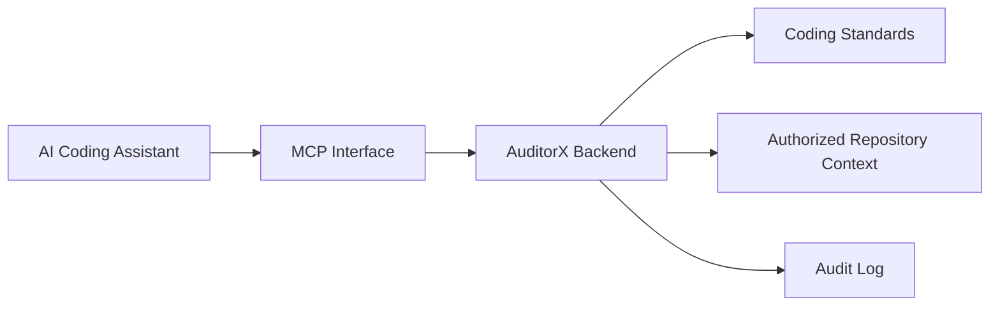

# MCP Prototype Architecture

> **Project:** AuditorX  
> **Technology:** Model Context Protocol  
> **Scope:** Prototype  
> **Status:** Draft

---

> **Implementation status: Not yet built.** This document describes planned/target
> architecture. No MCP server, endpoint, or integration exists in the repository as of
> 2026-09-12.

---

## 1. Purpose

MCP Prototype มีเป้าหมายเพื่อให้ AI Coding Assistant สามารถเข้าถึง Coding Standards, Best Practices และ Context ที่ AuditorX อนุญาต โดยไม่เปิดให้ AI เข้าถึงข้อมูลทั้งหมดโดยตรง

---

## 2. Scope

Prototype may support:

- list coding standards
- retrieve coding standard
- retrieve best-practice guidance
- retrieve limited repository context
- log MCP access

Not in scope:

- production-grade multi-tenant MCP gateway
- automatic source code modification
- unrestricted repository access
- support for every AI coding client

---

## 3. Architecture



---

## 4. Possible Resources

Conceptual resources:

```text
coding-standards
best-practices
project-guidelines
repository-context
```

Exact MCP resource/tool schema will be defined during POC.

---

## 5. Authorization

Every context request should be checked against:

- client/user identity if available
- repository permission
- requested resource
- allowed scope

---

## 6. Security

- expose minimum necessary context
- never expose secrets
- never return private repository content without authorization
- log access metadata
- treat MCP clients as external systems

---

## 7. Use Case

Related:
- `UC-011`
- `FR-MCP-*`

Flow:

```text
AI Coding Assistant
→ MCP Request
→ Validate
→ Authorize
→ Load Context
→ Filter Context
→ Return Result
→ Audit
```

---

## 8. POC Success Criteria

MCP POC is considered successful if:

1. compatible client connects
2. client requests a supported resource/tool
3. AuditorX returns authorized coding-standard context
4. unauthorized context is rejected
5. request is traceable in logs
