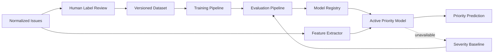

# Priority Engine Architecture

> **Project:** AuditorX  
> **Status:** Draft

---

> **Implementation status: Not yet built.** This document describes planned/target
> architecture. No priority/ML engine, feature extractor, model registry, or evaluation
> pipeline exists in the repository as of 2026-09-12. Findings currently carry only the
> Semgrep-derived severity (ERROR/WARNING/INFO mapped to High/Medium/Low) with no priority
> prediction or baseline layered on top — see `static-analysis.md`.

---

## 1. Purpose

กำหนด boundary ระหว่าง offline supervised training/evaluation และ online Issue Priority inference

## 2. Components



## 3. Offline Responsibilities

- validate human-reviewed labels
- build a repository-grouped dataset split
- fit candidate models
- evaluate candidates and baseline on identical partitions
- persist metrics, configuration and artifacts
- promote only a model that passes the documented criteria

Training must not execute inside an interactive scan request.

## 4. Online Responsibilities

- extract `priority-features-v1`
- load the Active model by immutable version
- produce class probabilities and predicted priority
- validate output enum and probability shape
- persist traceability metadata
- fall back to `severity-priority-v1` on failure

Priority inference must complete independently of the LLM provider.

## 5. Interfaces

```text
FeatureExtractor.Extract(issue, repositoryMetrics) -> FeatureVector
PriorityPredictor.Predict(featureVector, modelVersion) -> Prediction
PriorityBaseline.Predict(severity, baselineVersion) -> Prediction
ModelRegistry.GetActive(task) -> ModelVersion
EvaluationRunner.Evaluate(datasetVersion, candidates) -> EvaluationRun
```

## 6. Trust and Safety Boundaries

- raw credentials and secrets are never training features
- LLM output is not a training label or MVP feature
- model artifact checksum is verified before activation
- only authorized administrators may promote a model
- Reviewer label changes are append-only and auditable

## 7. Failure Behavior

Model load, feature validation or prediction failure must:

1. preserve the Semgrep finding
2. use the versioned severity baseline
3. record safe failure metadata
4. expose `priority_source = "baseline"`
5. leave deterministic Quality Score unchanged

## 8. Deployment

For the prototype, offline training may run as a separate command/job using Python libraries while the Go Backend consumes a versioned artifact through an adapter. The artifact format and serving mechanism remain replaceable behind `PriorityPredictor`.

## 9. Traceability

Related: `FR-PRIO-*`, `BR-015`–`BR-019`, `NFR-REL-005`, `NFR-MAIN-005`

