# Sequence Diagrams

> **Project:** AuditorX  
> **Status:** Draft

---

## 1. Purpose

Sequence Diagram ใช้อธิบายการติดต่อระหว่าง Actor และ Component สำหรับ Use Case ที่มี Integration หรือ Business Flow สำคัญ

ใช้รหัส:

```text
SD-<Use Case Number>
```

---

## 2. Sequence Diagram Index

| ID | Use Case |
|---|---|
| SD-001 | UC-001 Login |
| SD-002 | UC-002 Repository Management |
| SD-003 | UC-003 Source Code Scan |
| SD-004 | UC-004 AI Analysis |
| SD-005 | UC-005 Dashboard |
| SD-006 | UC-006 Issue Detail / Status |
| SD-008 | UC-008 Report Generation |
| SD-009 | UC-009 User Management |
| SD-010 | UC-010 Scan History |
| SD-011 | UC-011 MCP Context Access |
| SD-012 | UC-012 Priority Model Evaluation and Activation |

`UC-007` ไม่จำเป็นต้องมี Sequence Diagram แยกในระยะแรก เพราะเป็น Query/Filtering flow ที่ไม่ซับซ้อน

---

## 3. SD-001 Login

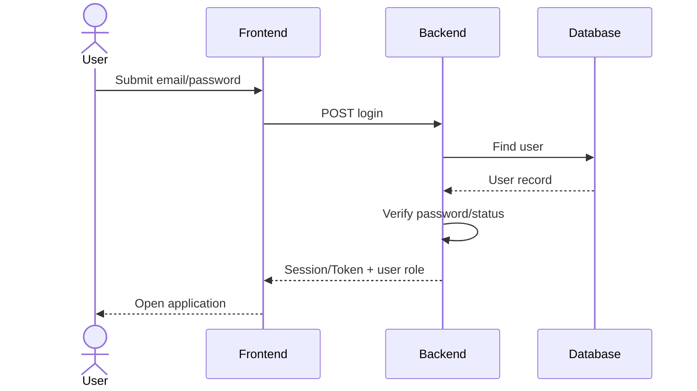

---

## 4. SD-002 Repository Management

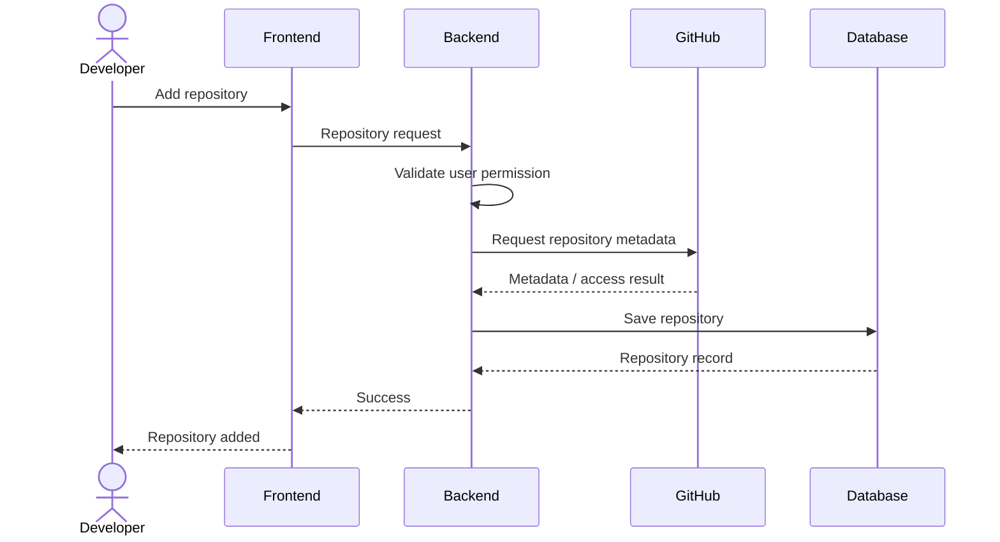

---

## 5. SD-003 Source Code Scan

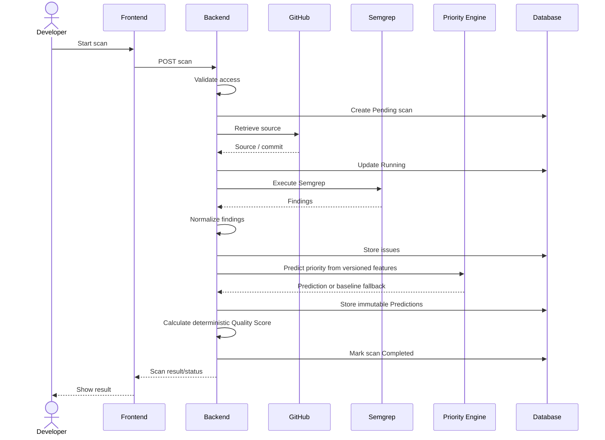

**Implementation status:** the enqueue → worker → source → Semgrep → store-issues portion is
implemented (in `postgres` mode with `SCAN_QUEUE_ENABLED=true`), with two corrections to the
diagram above: (1) the worker is a separate OS process that claims the job with
`FOR UPDATE SKIP LOCKED` and a lease token rather than the API executing the scan inline, and
(2) source retrieval resolves the branch to a commit SHA via the GitHub API before fetching that
commit's ZIP from `codeload.github.com`. The `Priority Engine` participant and the "Predict
priority" / "Store immutable Predictions" / "Calculate deterministic Quality Score" steps are
**not implemented** — see `priority-engine.md`. Findings are stored with their Semgrep-derived
severity only.

---

## 6. SD-004 AI Analysis

> **Implementation status: Not yet built.** No AI provider integration exists in the codebase
> as of 2026-09-12 (see `ai-engine.md`); this sequence is planned only.

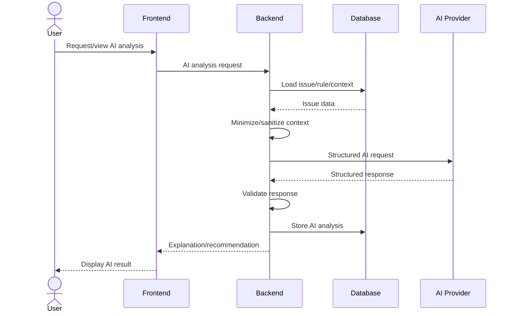

---

## 7. SD-005 Dashboard

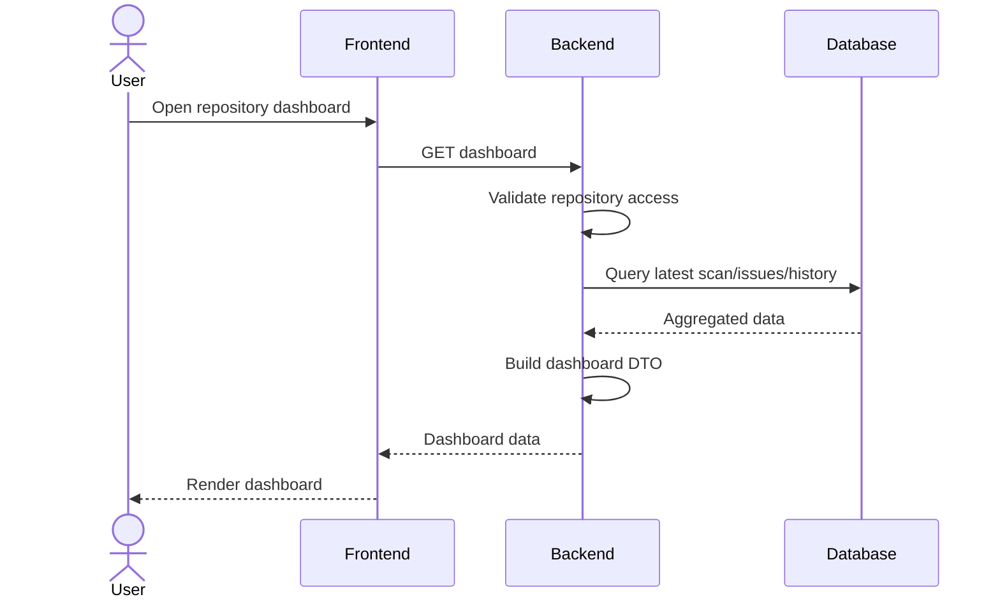

**Implementation status:** in `prototype` mode this is served entirely from the `audit`
module's hardcoded sample data. In `postgres` mode, `/api/v1/issues` and the generic dashboard
still use that same placeholder contract; the web UI instead uses scan-specific endpoints
(`GET /api/v1/repositories/{repo}/scans[...]`) for real results when `scan_queue` is enabled.

---

## 8. SD-006 Issue Detail / Status

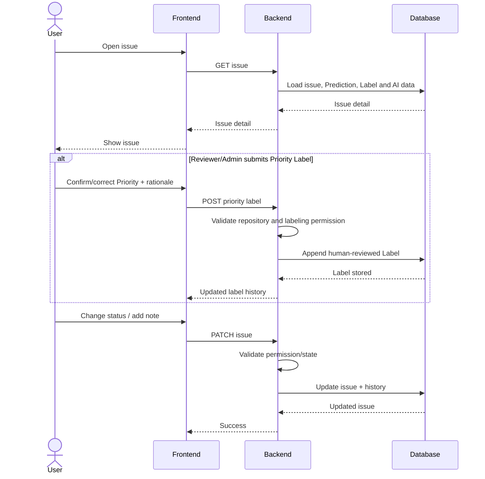

**Implementation status:** the "Confirm/correct Priority + rationale" / "POST priority label"
block is not implemented (no Priority Engine or Label storage exists — see
`priority-engine.md`); plain issue status/note updates are also not yet implemented as a
separate Issue service (see `backend.md`).

---

## 9. SD-008 Report Generation

> **Implementation status: Not yet built.** No Report Generator/service exists in the codebase
> as of 2026-09-12 (see `backend.md`); this sequence is planned only.

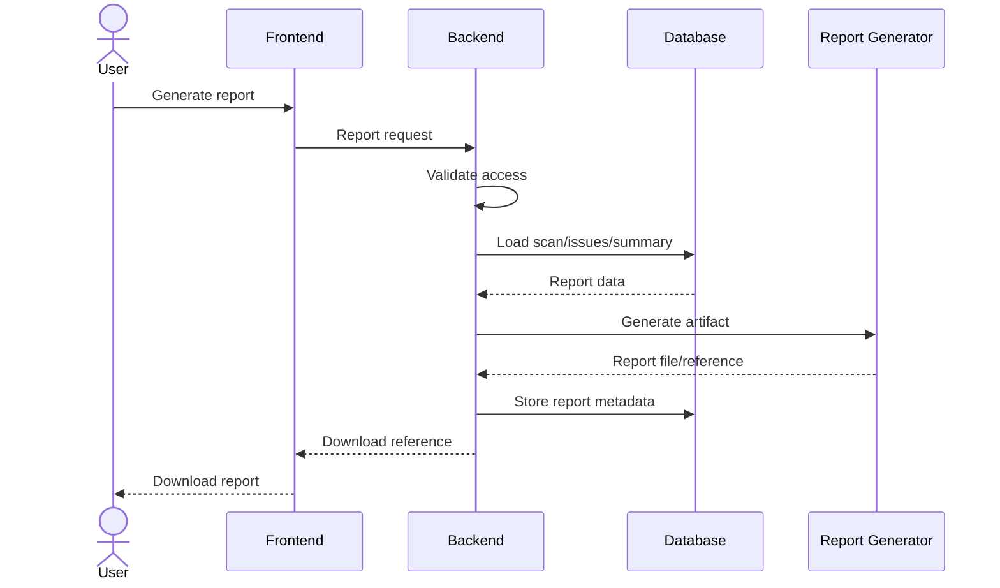

---

## 10. SD-009 User Management

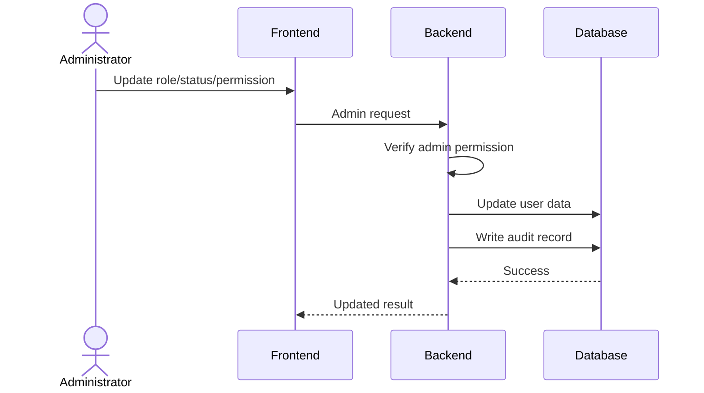

---

## 11. SD-010 Scan History

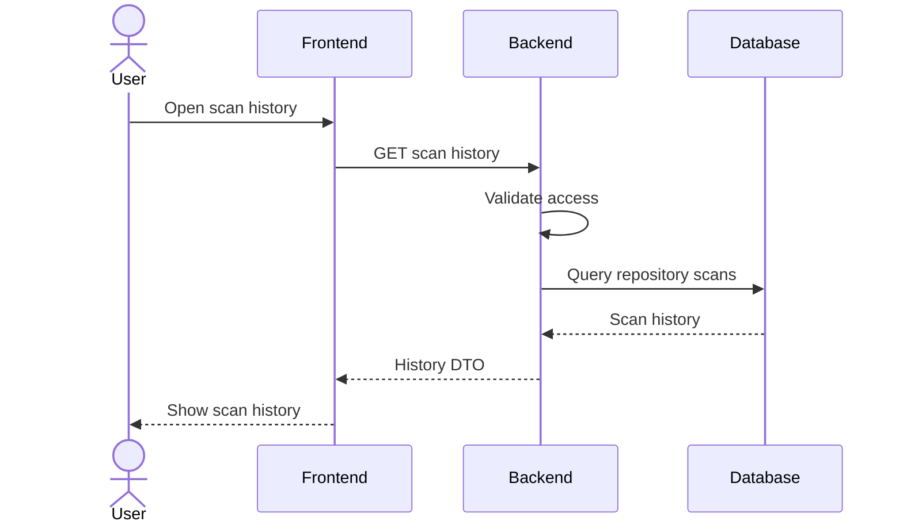

---

## 12. SD-011 MCP Context Access

> **Implementation status: Not yet built.** No MCP endpoint exists in the codebase as of
> 2026-09-12 (see `mcp.md`); this sequence is planned only.

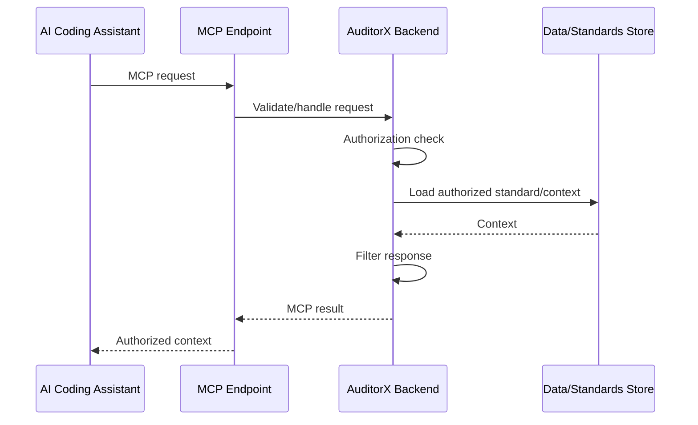

---

## 13. SD-012 Priority Model Evaluation and Activation

> **Implementation status: Not yet built.** No priority/ML engine, model registry or evaluation
> pipeline exists in the codebase as of 2026-09-12 (see `priority-engine.md`); this sequence is
> planned only.

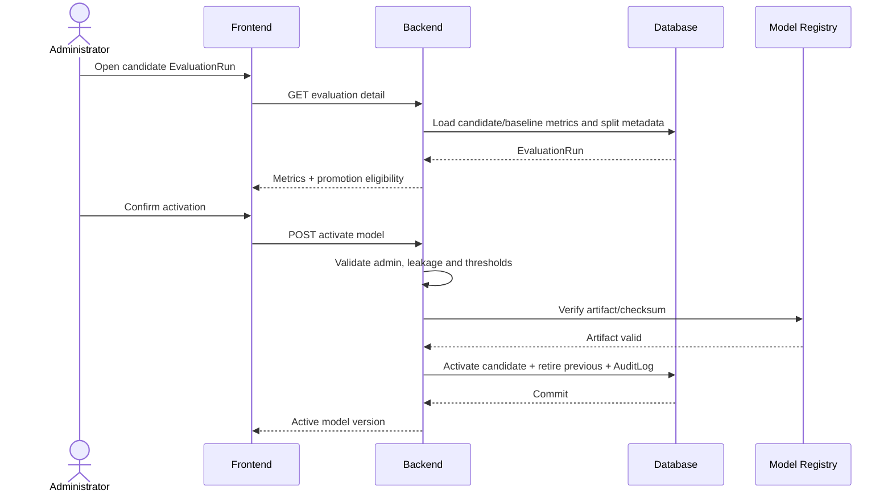

---

## 14. Traceability

| Sequence | Use Case |
|---|---|
| SD-001 | UC-001 |
| SD-002 | UC-002 |
| SD-003 | UC-003 |
| SD-004 | UC-004 |
| SD-005 | UC-005 |
| SD-006 | UC-006 |
| SD-008 | UC-008 |
| SD-009 | UC-009 |
| SD-010 | UC-010 |
| SD-011 | UC-011 |
| SD-012 | UC-012 |
