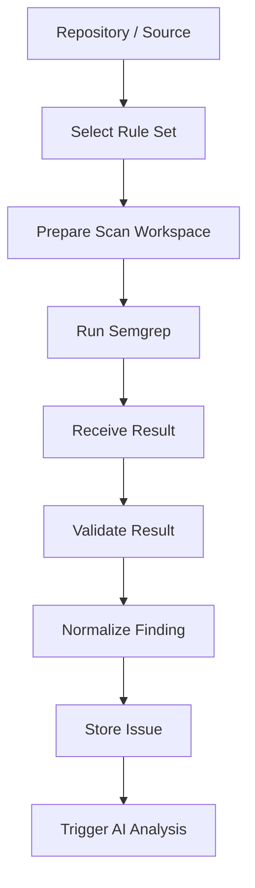

# Static Analysis Architecture

> **Project:** AuditorX  
> **Engine:** Semgrep Community Edition  
> **Status:** Draft

---

## 0. Implementation Status (as of 2026-09-12)

Implemented: the scan worker (`backend/internal/modules/scan`) invokes **Semgrep CE 1.175.0**
as a CLI subprocess. New scans use the fixed, embedded **`baseline-v2`** ruleset containing
**14 rules** for dynamic eval, disabled TLS verification, hardcoded secrets, shell command
execution, SQL string construction, sensitive logging and ignored Go JSON errors. The worker
also retains embedded `baseline-v1` support for historical or already-queued jobs. This is a
**versioned fixed baseline, not yet a configurable/pluggable rule-set system** —
sections 4 ("selected rules"), 6 and 8 ("Rule set should be configurable by language and scan
profile") below describe the target design, not the current behavior. Metrics/telemetry are
disabled, no network config/cache is inherited from the host, and each run uses a fresh
temporary directory that is cleaned up afterward. Source snippets from findings are not
currently persisted. Section 9 ("Trigger AI Analysis") is not implemented — there is no AI
engine in the codebase yet (see `ai-engine.md`).

---

## 1. Purpose

เอกสารนี้กำหนดบทบาทและ Integration Flow ของ Semgrep ใน AuditorX

Semgrep เป็น **Detection Engine** ไม่ใช่ AI layer

---

## 2. Responsibilities

Semgrep is responsible for:

- Rule-based source code detection
- Returning file and location
- Returning rule metadata
- Returning severity or mapped metadata
- Supporting language-specific rules

AuditorX is responsible for:

- Source preparation
- Rule selection
- Semgrep execution
- Finding normalization
- Persistence
- AI orchestration
- Issue lifecycle

---

## 3. Scan Flow



---

## 4. Input

- source path
- target language
- selected rules
- scan configuration

---

## 5. Expected Finding Fields

Normalized finding should include at least:

```text
rule_id
message
category
severity
file_path
start_line
start_column
end_line
end_column
code_snippet
finding_fingerprint
fingerprint_version
metadata
```

The fingerprint is a versioned matching aid for repeated findings across Scans; it is not a globally unique Issue ID and must not rely only on line number.

---

## 6. Internal Finding Model

Semgrep-specific response must be mapped into an AuditorX internal model so future analyzers can be added without changing issue-domain logic.

```text
Semgrep JSON
→ Semgrep Adapter
→ Internal Finding
→ Issue
```

---

## 7. Severity Mapping

Severity mapping must be versioned. The authoritative MVP mapping is defined in `docs/08-quality/semgrep-rules.md` as `semgrep-severity-v1`:

| Semgrep | AuditorX |
|---|---|
| ERROR | High |
| WARNING | Medium |
| INFO | Low |

The Scan record stores `severity_mapping_version`. `code-quality-score.md` consumes the normalized AuditorX severity and does not own this source mapping.

---

## 8. Rule Categories

Initial categories may include:

- Security
- Code Quality
- Coding Standard
- Best Practice

Rule set should be configurable by language and scan profile.

---

## 9. Failure Handling

Possible failure classes:

- invalid configuration
- unsupported language/rule
- source unavailable
- execution timeout
- process error
- malformed output

On failure:

1. mark scan failed
2. store error category
3. preserve scan metadata
4. notify user
5. do not fabricate findings

---

## 10. Security

- Run analyzer in controlled workspace
- Avoid executing project code
- Restrict file system access where possible
- Delete temporary source when no longer needed
- Validate paths
- Protect repository credentials

---

## 11. Traceability

Related:
- `UC-003`
- `FR-SCAN-*`
- `NFR-SEC-*`
- `NFR-REL-*`
