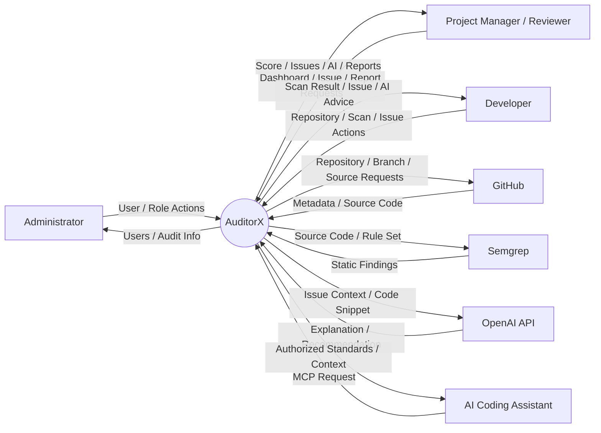

# AuditorX System Context

> **Project:** AuditorX  
> **Document:** System Context  
> **Status:** Draft  
> **Related SRS Section:** 4.3 แผนภาพบริบทของระบบ

---

## 1. Purpose

เอกสารนี้อธิบายขอบเขตของ AuditorX ผู้ใช้งาน ระบบภายนอก และข้อมูลที่แลกเปลี่ยนระหว่างระบบ

---

## 1.1 Implementation Status (as of 2026-09-12)

This document describes the full target system boundary. As implemented today, AuditorX
covers Authentication, Repository Management (create/get/list only), Scan Management, Semgrep
Integration and Finding storage, for **public GitHub repositories only**, running in a local
development environment. **AI-based explanation/recommendation, Code Quality Score, Dashboard
beyond the prototype's sample data, Reporting, and the MCP Prototype are not yet built** — the
`OpenAI API` and `AI Coding Assistant` external systems and their data flows (DF-006 through
DF-009) described below do not exist in the codebase yet. See `ai-engine.md`, `mcp.md` and
`backend.md` for details.

---

## 2. System Overview

AuditorX combines:

- Repository management
- Static Code Analysis using Semgrep
- AI-based explanation and recommendation
- Dashboard and issue management
- Reporting
- MCP Prototype

High-level flow:

```text
Repository
→ Semgrep
→ Findings
→ AuditorX
→ AI Analysis
→ Dashboard / Issue / Report
```

---

## 3. System Boundary

### Inside AuditorX

- Authentication
- Authorization
- User Management
- Repository Management
- Scan Management
- Semgrep Integration
- Finding Normalization
- Issue Management
- AI Analysis Orchestration
- Code Quality Score
- Dashboard
- Reporting
- Scan History
- Issue Status History
- Audit Logging
- MCP Prototype

### Outside AuditorX

- GitHub
- Semgrep
- OpenAI API
- AI Coding Assistant

---

## 4. External Actors and Systems

### Administrator

Sends:

- Login data
- User management actions
- Role and permission updates

Receives:

- User data
- Role data
- Audit information
- Operation status

### Project Manager / Reviewer

Sends:

- Dashboard requests
- Filters
- Issue review actions
- Report requests

Receives:

- Quality Score
- Issue summaries
- AI recommendations
- Reports

### Developer

Sends:

- Repository data
- Branch selection
- Scan commands
- Issue status updates

Receives:

- Scan status
- Findings
- Code location
- AI recommendation
- Quality Score

### GitHub

AuditorX requests:

- Repository metadata
- Branch information
- Commit information
- Source code

GitHub returns:

- Repository metadata
- Branches
- Commit SHA
- Source code
- API errors

### Semgrep

AuditorX provides:

- Source code
- Rule Set
- Scan configuration

Semgrep returns:

- Rule ID
- Message
- File
- Line
- Column
- Severity
- Metadata

### OpenAI API

AuditorX provides:

- Issue context
- Rule information
- Relevant code snippet
- Programming language
- Analysis instruction

OpenAI API returns:

- Explanation
- Potential impact
- Recommendation
- Explanation of the supplied persisted Priority
- Repository summary

### AI Coding Assistant

Requests:

- Coding Standards
- Best Practices
- Authorized Repository Context

Receives:

- Authorized context via MCP

---

## 5. System Context Diagram



---

## 6. Primary Data Flows

| ID | Source | Destination | Data |
|---|---|---|---|
| DF-001 | User | AuditorX | Credentials / User Actions |
| DF-002 | AuditorX | GitHub | Repository Requests |
| DF-003 | GitHub | AuditorX | Metadata / Source Code |
| DF-004 | AuditorX | Semgrep | Source Code / Rule Set |
| DF-005 | Semgrep | AuditorX | Static Findings |
| DF-006 | AuditorX | OpenAI API | Issue Context / Code Snippet |
| DF-007 | OpenAI API | AuditorX | Explanation / Recommendation |
| DF-008 | AI Coding Assistant | AuditorX | MCP Request |
| DF-009 | AuditorX | AI Coding Assistant | Authorized Context |

---

## 7. Trust Boundaries

```text
Users
  │
  ▼
[Trust Boundary]
  │
  ▼
AuditorX
  ├── [Trust Boundary] ── GitHub
  ├── [Trust Boundary] ── OpenAI API
  └── [Trust Boundary] ── AI Coding Assistant
```

External input must be validated before processing or persistence.

---

## 8. Security Considerations

- Private repositories require authorization. **Current state: private repositories are not
  supported at all** — no credential/token support exists in the code; only public repositories
  can be registered and scanned.
- API keys and access tokens must not be logged in plaintext.
- Temporary source code should be removed when no longer required.
- Only minimum necessary code context should be sent to AI.
- Sensitive credentials discovered in source code should not be forwarded to AI without control.
- MCP must only expose authorized context.

---

## 9. Failure Scenarios

### GitHub Unavailable

- Stop retrieval
- Record error
- Mark operation failed
- Notify user

### Semgrep Failure

- Record scan failure
- Preserve scan metadata
- Store error information
- Notify user

### OpenAI API Failure

- Preserve Semgrep findings
- Mark AI analysis failed/unavailable
- Allow review of static findings
- Allow retry

### Database Failure

- Return controlled error
- Avoid reporting incomplete operations as successful
- Record diagnostics when possible

---

## 10. Architectural Principles

### Separation of Concerns

- Semgrep → Detect
- AI → Explain and Recommend
- AuditorX → Orchestrate, Store and Present

### Least Privilege

Users and integrations only access required resources.

### AI as Advisory

AI output supports decisions and is not automatically applied to source code.

### Graceful Degradation

Static analysis remains usable when AI is unavailable.

### Traceability

```text
Repository
→ Branch
→ Commit
→ Scan
→ Finding / Issue
→ AI Analysis
```

---

## 11. Related Requirements

| Context Component | Requirements |
|---|---|
| Authentication | `FR-AUTH-*` |
| Repository | `FR-REP-*` |
| Static Analysis | `FR-SCAN-*` |
| AI Analysis | `FR-AI-*` |
| Dashboard | `FR-DASH-*` |
| Issue Management | `FR-ISSUE-*` |
| Reporting | `FR-REPORT-*` |
| User Management | `FR-USER-*` |
| MCP | `FR-MCP-*` |
| Security | `NFR-SEC-*` |
| Reliability | `NFR-REL-*` |

---

## 12. Open Design Questions

- GitHub authentication flow
- Repository retrieval strategy
- Final Semgrep rule IDs included in each MVP profile
- Scan execution model
- Temporary source storage strategy
- MCP Resources and Tools
