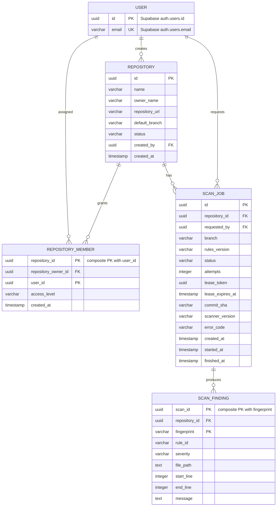
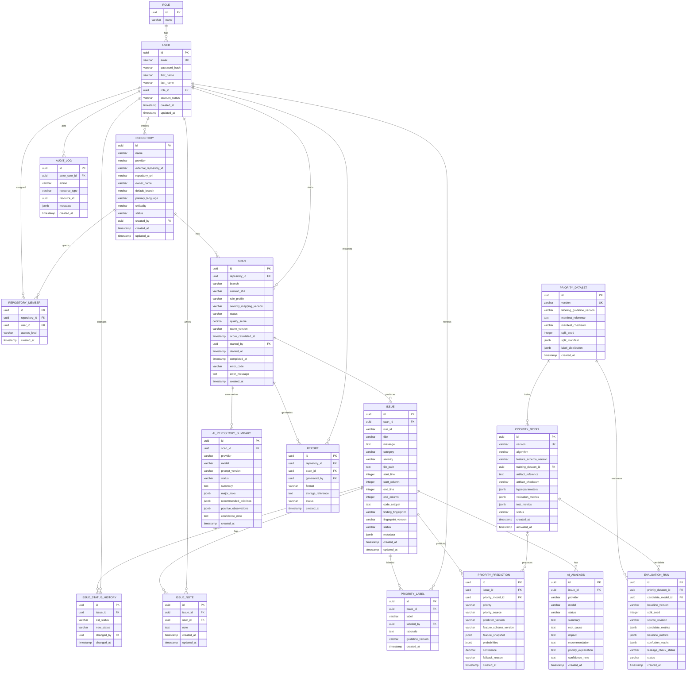

# ER Diagram

> **Project:** AuditorX  
> **Status:** Draft

**Implementation status (as of 2026-09-12):** The diagram below is the full **planned/target** ER model. Only four tables exist in the codebase today: `repositories`, `repository_members`, `scan_jobs`, and `scan_findings` (see `supabase/migrations/20260828073925_repository_membership.sql` and `supabase/migrations/20260828102015_durable_scan_jobs.sql`), all with Row Level Security enabled and forced. `USER` is not a local table — it is Supabase Auth's `auth.users`. `SCAN` is implemented as `scan_jobs`. `ISSUE` as a stateful entity does not exist; the implemented analog is the immutable `scan_findings` table (no status, notes, or history). Everything else below — `ROLE`, `ISSUE_STATUS_HISTORY`, `ISSUE_NOTE`, `PRIORITY_LABEL`, `PRIORITY_PREDICTION`, `PRIORITY_DATASET`, `PRIORITY_MODEL`, `EVALUATION_RUN`, `AI_ANALYSIS`, `AI_REPOSITORY_SUMMARY`, `REPORT`, `AUDIT_LOG` — has no corresponding table. See "Currently Implemented ER Diagram" below for the as-built subset, and §5 in `data-model.md` / the corresponding sections of `data-dictionary.md` for field-level detail.

## Currently Implemented ER Diagram

## Full Planned ER Diagram (target design)

## Notes

- Field types are conceptual and may be refined during implementation.
- `uuid` is the recommended identifier type for the initial design.
- `jsonb` is appropriate for analyzer metadata that does not justify fixed columns.
- `AI_ANALYSIS` can have multiple records per issue to preserve re-analysis history.
