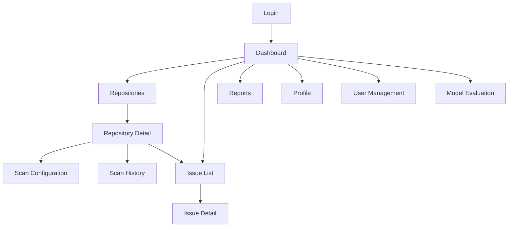

# UI Navigation

> **Project:** AuditorX  
> **Document:** Navigation Structure  
> **Status:** Draft

---

## 1. Purpose

เอกสารนี้กำหนดโครงสร้างการนำทางหลักของ AuditorX เพื่อให้ Frontend, UX และ Test Cases ใช้โครงสร้างหน้าจอเดียวกัน

---

## 2. Main Navigation

Suggested main navigation:

```text
Dashboard
Repositories
Issues
Reports
Administration
Profile
Logout
```

Visibility depends on role.

**Implementation status:** The actual sidebar (`frontend/components/layout/dashboard-shell.tsx`) currently has two static groups shown to every signed-in user, with no role-based visibility yet:

```text
Workspace
  Overview          -> /dashboard   (implemented)
  Repositories      -> /repositories (implemented)
  Issues            (disabled, labeled "Soon")
  Scan history       (disabled, labeled "Soon" — scan history is reachable today from inside the Dashboard/Scans workspace, not as its own nav item)
  Reports           (disabled, labeled "Soon")

Management
  Team              (disabled, labeled "Soon" — stands in for "User Management"/"Administration")
  Model evaluation  (disabled, labeled "Soon")
  Settings          (disabled, labeled "Soon")
```

There is no separate "Profile" nav item; a logout control is shown at the bottom of the sidebar instead. Every user sees the same sidebar regardless of role — the "Visibility depends on role" and role-based sections below (Section 4) describe the target design, not current behavior.

---

## 3. Sitemap



---

## 4. Role-based Navigation

**Implementation status: Not yet built.** The frontend does not currently vary the sidebar by role; the sections below describe the planned target, not shipped behavior. Access to individual repositories, and gating of the Start/Cancel scan actions to owner/editor `access_level`, is enforced today (see `docs/07-ui/screen-specifications.md`), but the navigation menu itself is not role-aware.

### Administrator

Can access:

- Dashboard
- Repositories
- Issues
- Reports
- Scan History
- User Management
- Model Evaluation
- Profile

### Project Manager / Reviewer

Can access:

- Dashboard
- Repositories (view as permitted)
- Issues
- Reports
- Scan History
- Profile

### Developer

Can access:

- Dashboard
- Repositories
- Scan
- Issues
- Reports
- Scan History
- Profile

---

## 5. Navigation Rules

1. User must authenticate before accessing protected screens.
2. Backend remains the source of truth for permissions.
3. Frontend may hide unavailable navigation items.
4. Direct URL access must still be checked by backend/API.
5. Repository-specific screens require repository access.
6. If resource is inaccessible, show Forbidden or Not Found state as appropriate.

---

## 6. Traceability

| Screen Area | Use Case |
|---|---|
| Login | `UC-001` |
| Repository | `UC-002`, `UC-010` |
| Scan | `UC-003` |
| AI Result | `UC-004` |
| Dashboard | `UC-005` |
| Issue | `UC-006`, `UC-007` |
| Report | `UC-008` |
| User Management | `UC-009` |
