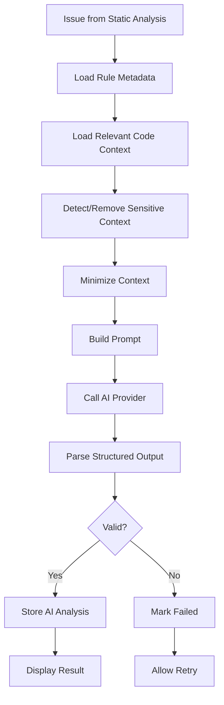

# AI Analysis Flow

> **Project:** AuditorX  
> **Status:** Draft  
> **Related Use Case:** `UC-004`  
> **Related Requirements:** `FR-AI-*`

---

> **Implementation status: Not yet built.** This document describes planned AI functionality; no corresponding code exists in the repository as of 2026-09-12. All Semgrep scan results today are shown to users exactly as the scanner produces them, with no AI explanation, summary, or prioritization layer. The flow below remains valid planned design for future implementation.

---

## 1. Purpose

กำหนดขั้นตอน AI Analysis ตั้งแต่รับ Issue จนจัดเก็บผลวิเคราะห์

---

## 2. High-Level Flow



---

## 3. Inputs

Required conceptual inputs:

- issue ID
- language
- rule ID
- rule message
- severity
- category
- file path
- code snippet
- limited surrounding context
- persisted predicted priority
- priority source, predictor version and confidence/probabilities

Optional:

- repository conventions
- project coding standard
- nearby symbol/function context

---

## 4. Context Minimization

Use:

```text
Finding
+ Rule
+ Relevant Snippet
+ Required Surrounding Context
```

Avoid:

```text
Entire Repository
```

unless an explicitly approved future workflow requires it.

---

## 5. Sensitive Data Handling

Before sending context:

- detect obvious secrets if feasible
- mask credentials
- exclude environment/config secrets
- avoid unrelated files
- avoid personal data not required for analysis

---

## 6. Analysis Tasks

AI should return:

1. concise explanation
2. probable root cause
3. possible impact
4. recommended remediation
5. explanation of the persisted system priority
6. uncertainty/confidence note

---

## 7. Validation

AI response must be validated against a structured schema.

Invalid responses:

- must not be stored as completed
- may be retried
- should preserve raw provider diagnostic metadata only if safe and necessary

---

## 8. Persistence

AIAnalysis should preserve:

- issue_id
- provider
- model
- status
- summary
- root_cause
- impact
- recommendation
- priority_explanation
- confidence_note
- created_at

Multiple analyses may exist for one Issue.

The AIAnalysis record stores an explanation of a persisted Priority, not the Prediction itself. Priority Prediction and human-reviewed Label remain in their dedicated append-only entities.

Repository-level output is persisted separately as `AIRepositorySummary` and preserves:

- scan_id
- provider
- model
- prompt_version
- status
- summary
- major_risks
- recommended_priorities
- positive_observations
- confidence_note
- created_at

Multiple summaries may exist for one Scan so retries and model/prompt changes remain traceable. The Dashboard uses the latest Completed summary.

---

## 9. Failure Behavior

AI failure does not fail completed Static Analysis.

```text
Semgrep Completed
+
AI Failed
=
Scan remains valid
```

User can still view:

- rule
- file
- line
- severity
- static message

---

## 10. Re-analysis

Re-analysis may occur when:

- provider request failed
- user requests retry
- model/prompt version changes
- additional context becomes available

Historical AI analysis should not be silently overwritten if history is required.

---

## 11. Traceability

- `UC-004`
- `FR-AI-001` through `FR-AI-009`
- `NFR-SEC-007`
- `NFR-SEC-008`
- `NFR-REL-001`
