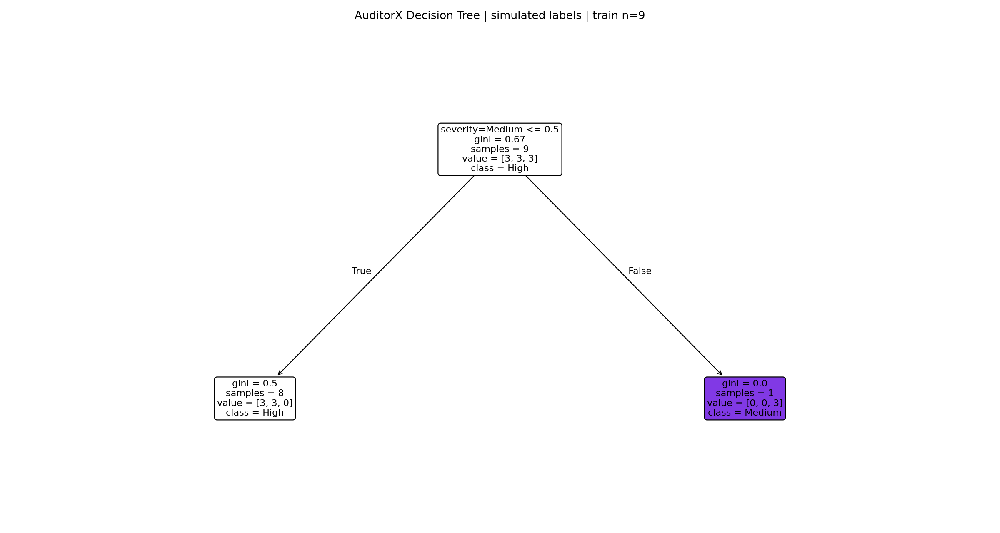
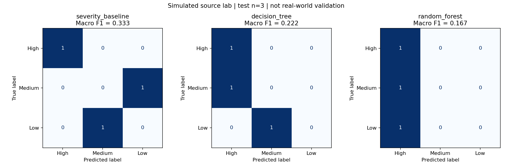

# AuditorX coursework experiment

Primary model: Decision Tree (lecture-aligned).

SIMULATED LABELS. This is a pipeline demonstration, not real-world validation.

Train / validation / test: 9 / 3 / 3. Legacy case-family evaluation frozen; supplemental projects training-only.
Tree max_depth=1, selected on validation Macro F1, shallowest wins ties.

| Method | Test accuracy | Test Macro F1 |
|---|---:|---:|
| severity_baseline | 0.333 | 0.333 |
| decision_tree | 0.333 | 0.222 |
| random_forest | 0.333 | 0.167 |

## Limitations

- Only 9 train, 3 validation and 3 test rows; evaluation remains from one authored lab.
- Supplemental projects are training-only; legacy lab is split by authored case family, not held out by whole project.
- Simulated labels, not human-confirmed production priorities.
- Test families were already examined in the earlier experiment; not a fresh blind benchmark.
- Constant context features cannot teach context-dependent prioritization.
- No claim of performance on unseen real projects.

Constant features: language, repository_criticality, exposure

Next: obtain diverse labeled projects/scenarios, freeze new group-held-out test data,
then evaluate before integrating predictions into the dashboard.
