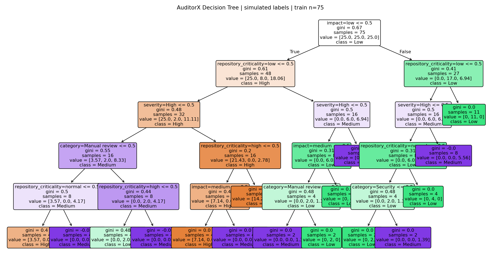
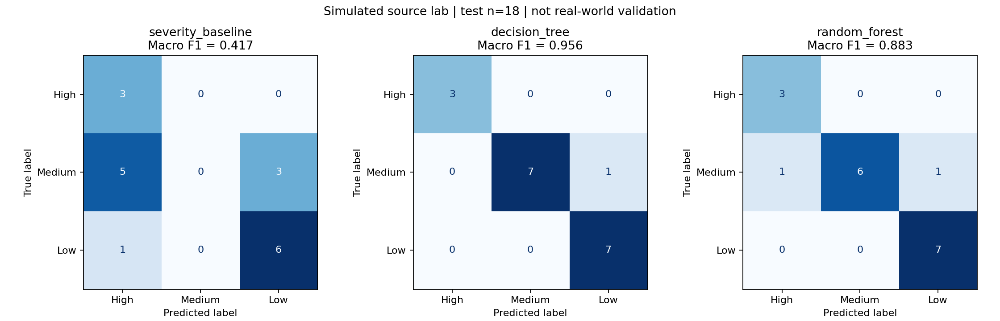

# AuditorX coursework experiment

Primary model: Decision Tree (lecture-aligned).

SIMULATED LABELS. This is a pipeline demonstration, not real-world validation.

Train / validation / test: 75 / 18 / 18. Source families grouped; supplemental projects training-only.
Tree max_depth=5, selected on validation Macro F1, shallowest wins ties.

| Method | Test accuracy | Test Macro F1 |
|---|---:|---:|
| severity_baseline | 0.500 | 0.417 |
| decision_tree | 0.944 | 0.956 |
| random_forest | 0.889 | 0.883 |

## Limitations

- Twelve derived source fixture projects, not twelve independently developed production apps.
- Nine context copies per family are correlated; families and unsafe/fixed pairs stay in one split.
- Shared mock boilerplate is not an example and is never used as a model feature.
- Labels come from a declared simulator rubric, not human ground truth.
- Family templates were examined previously; evaluation is not a new blind real-project benchmark.
- Scores measure reproduction of the rubric, not real-world vulnerability severity or repair value.
- Supplemental inventory-card labels are assistant-authored, test-only and training-only.

Constant features: language, exposure

Next: obtain diverse labeled projects/scenarios, freeze new group-held-out test data,
then evaluate before integrating predictions into the dashboard.
